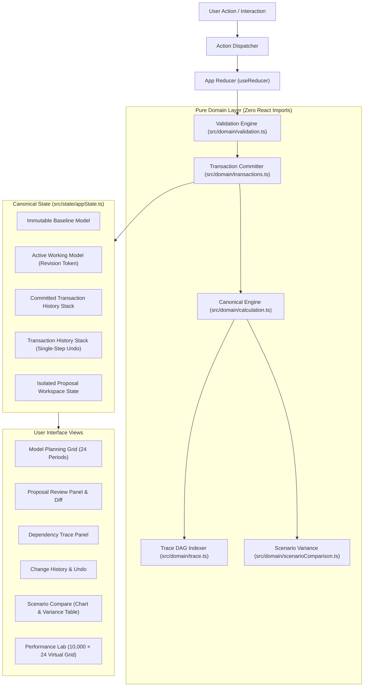
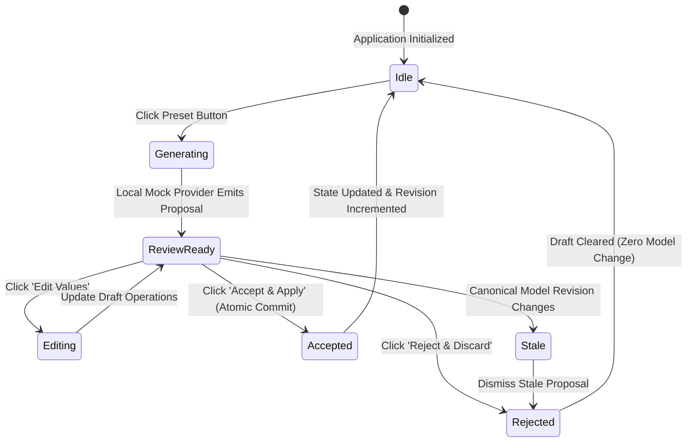

# Model Change Review Lab

> **Notice:** This project is an independent engineering prototype developed as a proof of concept. It has **no official affiliation with Drivetrain AI**, uses **100% synthetic financial data**, and simulates AI proposals using a deterministic local provider with **zero external AI APIs, LLMs, or network services**.

---

## 1. Project Overview

The **Model Change Review Lab** explores an architectural question in financial planning and business modeling:

> _How can an AI-assisted planning application allow generative suggestions and complex multi-cell scenario updates while preserving strict financial integrity, reviewability, auditability, and mathematical traceability?_

Spreadsheet and FP&A tools traditionally struggle when automation mutates cell values directly without reviewable transaction boundaries. The Model Change Review Lab demonstrates an architectural pattern designed to solve this problem:

1. **Independent Verification & Proposal Lifecycle:** AI outputs are structured _proposals_ (lists of targeted cell operations), never direct mutations. They are previewed in isolation, inspected via clear before/after diffs, edited if necessary, and accepted or rejected by human operators.
2. **Atomic Transaction Commits:** Accepting a proposal commits all operations atomically into the canonical state tree, recording a transactional snapshot with before/after audit records.
3. **Monotonic Revision Safety:** Any concurrent edit, undo, or reset increments the revision token, instantly invalidating stale proposals and preventing accidental overwrites.
4. **DAG Formula Traceability:** Every calculated metric across 24 monthly periods is connected to an explicit directed acyclic graph (DAG) node, enabling users to click any output cell to inspect its exact formula, dependencies, and underlying inputs.
5. **Headless Virtualization & Performance Stress-Testing:** An isolated Performance Lab demonstrates row windowing across a 10,000-row × 24-column dataset (240,000 cells) using `@tanstack/react-virtual`, providing honest, reproducible benchmarks.

---

## 2. Architecture & Data Flow

The application follows a unidirectional data flow separating pure domain logic from React UI components.

### System Architecture Flow



### Proposal Workflow State Machine



---

## 3. Financial Model Formulas & Invariants

All calculations are executed exclusively by the pure function `calculateModel` in [`src/domain/calculation.ts`](src/domain/calculation.ts). No financial formulas exist in React components.

All monetary values are rounded to two decimal places using `roundMoney(v) = Math.round(v * 100) / 100`.

### Exact Domain Formulas

| Metric                 | Horizon Period  | Formula Specification                               |
| ---------------------- | --------------- | --------------------------------------------------- |
| **Revenue ($)**        | Period $t = 1$  | `roundMoney(startingRevenue * (1 + growthRate[1]))` |
| **Revenue ($)**        | Period $t > 1$  | `roundMoney(revenue[t-1] * (1 + growthRate[t]))`    |
| **Total FTE**          | All periods     | `engineeringFte[t] + otherFte[t]` _(integer)_       |
| **Payroll ($)**        | All periods     | `roundMoney(totalFte[t] * costPerFte[t])`           |
| **Total OpEx ($)**     | All periods     | `roundMoney(payroll[t] + otherOpex[t])`             |
| **EBITDA ($)**         | All periods     | `roundMoney(revenue[t] - totalOpex[t])`             |
| **Ending Cash ($)**    | Period $t = 1$  | `roundMoney(startingCash + ebitda[1])`              |
| **Ending Cash ($)**    | Period $t > 1$  | `roundMoney(endingCash[t-1] + ebitda[t])`           |
| **Cumulative Revenue** | Horizon M01–M24 | `sum(revenue[1] .. revenue[24])`                    |

### Validation Rules

All manual cell edits and proposed operations are validated prior to commit:

| Field                   | Type       | Min Bound       | Max Bound           | Rejection Handling                   |
| ----------------------- | ---------- | --------------- | ------------------- | ------------------------------------ |
| **Starting Revenue**    | Currency   | $0.00           | $1,000,000,000.00   | Rejected with inline error           |
| **Starting Cash**       | Currency   | $0.00           | $1,000,000,000.00   | Rejected with inline error           |
| **Revenue Growth Rate** | Percentage | -50.0% (-0.50)  | +50.0% (+0.50)      | Rejected with inline error           |
| **Engineering FTE**     | Integer    | 0               | 1,000               | Non-integers / out of range rejected |
| **Other FTE**           | Integer    | 0               | 1,000               | Non-integers / out of range rejected |
| **Cost per FTE**        | Currency   | $1.00           | $100,000.00         | Negative / excessive values rejected |
| **Other OpEx**          | Currency   | $0.00           | $1,000,000,000.00   | Negative / excessive values rejected |

---

## 4. Setup, Development & Verification Commands

### Prerequisites

- **Node.js:** v22.x LTS (primary CI and local development; Netlify runs Node 20.x LTS)
- **Package Manager:** `npm` (with committed `package-lock.json`)

### Command Reference

```bash
# 1. Install all dependencies reproducibly
npm ci

# 2. Start local Vite development server
npm run dev

# 3. Typecheck codebase with strict TypeScript
npm run typecheck

# 4. Run ESLint source analysis
npm run lint

# 5. Verify Prettier code formatting
npm run format

# 6. Execute full Vitest unit & integration test suite (20 test suites, 114 tests)
npm test -- --run

# 7. Compile optimized production build
npm run build

# 8. Serve production build locally
npx vite preview --port 4173

# 9. Run Playwright End-to-End & automated Axe-core accessibility tests
npm run test:e2e
```

---

## 5. Performance Lab: Methodology & Benchmarks

The Performance Lab ([`src/features/performance/`](src/features/performance/)) is an isolated module designed to stress-test DOM virtualization using a deterministic **10,000-row × 24-column synthetic dataset (240,000 cells)**.

### Non-Negotiable Invariants

- The synthetic dataset is generated inside the performance feature and is **never passed to `calculateModel`**.
- Measurements are honest: missing or unrun metrics report **"Not measured"**, and failures report **"Unavailable"** (never false `0 ms`).
- Diagnostic targets are reference objectives, not guaranteed thresholds across all hardware.

### Benchmark Definitions & Observed Production Results

Measurements collected directly in headless Google Chrome running on a reference 16-core Linux workstation against the production build:

| Metric                           | Target (Diagnostic) | Observed (Production Build)                   | Measurement Methodology                                                                                                                          |
| -------------------------------- | ------------------- | --------------------------------------------- | ------------------------------------------------------------------------------------------------------------------------------------------------ |
| **Dataset Generation**           | Diagnostic          | **5.3 ms**                                    | Pure in-memory generation of 10,000 × 24 numbers via `performance.now()`. Kept completely separate from React layout/render cycles.              |
| **Time to Grid Ready**           | `< 500 ms`          | **27.5 ms**                                   | Measured from the user's "Run Benchmark" click to the first committed virtual grid layout using `performance.now()` in a `useLayoutEffect` hook. |
| **Mounted Body Rows**            | `< 100 rows`        | **20 rows**                                   | Querying actual mounted DOM elements (`[data-virtual-row="true"]`). Proves that only the visible viewport window + overscan is mounted.          |
| **Canonical Model Recompute**    | `< 10 ms`           | **< 1.0 ms** _(0.00 ms displayed)_            | Direct invocation of `calculateModel(seedAssumptions)` across 24 periods. Pure calculation duration separate from React state updates.           |
| **Edit Input-to-Commit Latency** | p95 `< 100 ms`      | **p50: 0.1 ms \| p95: 0.1 ms** _(30 samples)_ | Measures duration from cell edit event to committed layout state across 30 real synthetic cell edit iterations.                                  |

> **Measurement Note:** Edit latency is accurately labeled as **input-to-commit latency** (measured to React commit/layout effect). It does not represent full browser frame presentation/paint time.

---

## 6. Accessibility & Responsive Design

- **WCAG 2.2 AA Compliance:** Zero automated Axe violations across all primary routes (Model Grid, Proposal Review, Trace Panel, History, Scenario Compare, Performance Lab).
- **Keyboard Navigation:** Full arrow key navigation across grid cells, `Enter` to edit / trace, `Escape` to cancel, and `Tab` through editable cells.
- **Focus Management:** Focus returns to the invoking control when drawers and confirmation dialogs close.
- **Reduced Motion Support:** `@media (prefers-reduced-motion: reduce)` disables non-essential animations and transitions.
- **Responsive Viewports:** Tested down to 375px mobile viewports with zero page-level horizontal overflow. Complex tables scroll within dedicated containers.

---

## 7. Known Limitations & Prototype Boundaries

1. **Simulated AI Provider:** Change proposals are generated deterministically by local mock templates. No live LLM or external API is queried.
2. **Synthetic Data Only:** The baseline figures ($750k starting revenue, $3M cash) and synthetic 10k grid are completely synthetic test fixtures.
3. **Session-Scoped History:** Change history and undo snapshots exist in memory for the duration of the browser session; there is no persistent database.
4. **Diagnostic Benchmarks:** Performance timings depend on the client machine's processor and browser engine and should be interpreted as diagnostic indicators.
