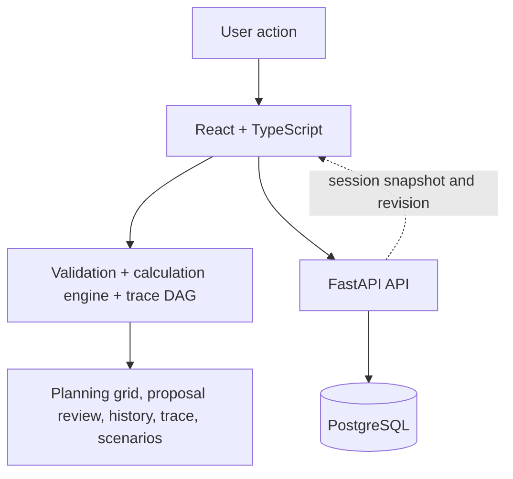
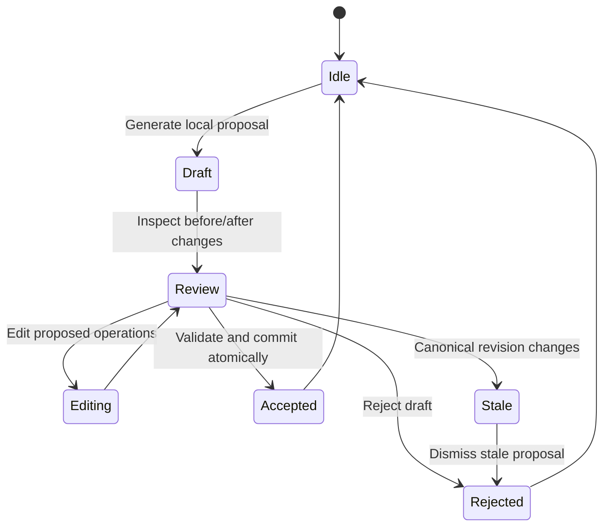

# Model Change Review Lab

**Review model changes before they reach canonical state.**

[](https://github.com/Satjeet2005/model-change-review-lab/actions/workflows/ci.yml) · [Architecture](#architecture-and-data-flow) · [Local setup](#local-development) · [Deployment guide](docs/DEPLOYMENT.md) · [Portfolio](https://satjeet.me)

> **Scope:** An independent engineering proof of concept with no official affiliation with Drivetrain AI. It uses synthetic financial data and deterministic local proposal templates. It does **not** call a live LLM or external AI API.

## The problem

A proposed change to a financial model can affect multiple linked cells. Users need to inspect the exact changes before applying them, avoid committing proposals based on stale state, and trace calculated outputs back to their inputs.

Model Change Review Lab explores a review-first workflow: suggestions remain isolated drafts until they are validated and explicitly accepted.

## What it demonstrates

- **Review before write** — proposals are isolated operations with before/after diffs; users can edit or reject them without changing the canonical model.
- **Atomic commits** — accepted operations are validated and committed together, with persisted transaction history.
- **Revision-aware safety** — later edits invalidate stale proposals rather than allowing them to overwrite newer state.
- **Formula traceability** — a dependency DAG connects calculated outputs to the formulas and inputs behind them.
- **Virtualized data grids** — a separate Performance Lab exercises a 10,000 × 24 synthetic grid (240,000 cells) without passing that fixture through the financial calculation engine.

## Architecture and data flow

| Layer | Responsibility |
| --- | --- |
| React 19 + TypeScript | UI, the single authoritative calculation engine, proposal review, formula tracing, and scenario comparison |
| FastAPI + Python 3.12 | API validation, revision coordination, persistence workflows, and transaction history |
| PostgreSQL 16 | Workspace/session state, hashed capability tokens, and audit transactions |
| Verification | GitHub Actions CI, Vitest, pytest, Playwright, and Axe accessibility checks |



The key boundary is deliberate: financial formulas are implemented only in the TypeScript domain engine; the backend validates and persists state and coordinates concurrent mutations.

### Proposal lifecycle



## Engineering invariants

- Suggestions are proposed operations, never direct model mutations.
- Calculations have one authoritative implementation in `src/domain/calculation.ts`.
- Formula tracing is indexed in `src/domain/trace.ts` and supports output-to-input inspection.
- Revision changes invalidate stale proposals; backend mutations use database concurrency controls.
- Performance figures are reported as measured, unavailable, or targets—not fabricated zeroes or guaranteed timings.

See the [full backend architecture](docs/implementation/FULL_STACK_BACKEND_ARCHITECTURE.md) for schema, locking, persistence, and concurrency details.

## Local development

### Requirements

- Node.js 22
- Python 3.12 and [`uv`](https://docs.astral.sh/uv/)
- Docker with Docker Compose

### 1. Start PostgreSQL

From the repository root:

```bash
docker compose up -d
```

The development database is bound to `127.0.0.1:5432` by default. Backend defaults are configured in `backend/app/config.py`; override them through environment variables when needed.

### 2. Start the API

In terminal 1:

```bash
cd backend
uv sync --locked
uv run alembic upgrade head
uv run uvicorn app.main:app --reload --host 127.0.0.1 --port 8000
```

### 3. Start the frontend

In terminal 2, from the repository root:

```bash
npm ci
cp .env.example .env
npm run dev
```

The example config points the frontend to `http://127.0.0.1:8000`. The API's interactive documentation is available at `http://127.0.0.1:8000/docs` while the backend is running.

## Verification

GitHub Actions runs the backend and frontend checks against PostgreSQL 16, Python 3.12, and Node.js 22, including Playwright end-to-end and automated accessibility tests.

Run individual checks locally:

```bash
# Backend, from backend/
uv run ruff check app tests
uv run ruff format --check app tests
uv run pytest

# Frontend, from the repository root
npm run typecheck
npm run lint
npm run format
npm test -- --run
npm run build
npm run test:e2e
```

The backend test suite uses an isolated test database. Keep `TEST_DATABASE_URL` pointed at a separate test database; the test setup is designed to fail closed rather than run against the application database.

## Financial model rules

All calculations use the pure `calculateModel` function in `src/domain/calculation.ts`. Monetary outputs are rounded to two decimal places with `roundMoney(v) = Math.round(v * 100) / 100`.

| Metric | Formula |
| --- | --- |
| Revenue, first period | `roundMoney(startingRevenue * (1 + growthRate[1]))` |
| Revenue, later periods | `roundMoney(revenue[t-1] * (1 + growthRate[t]))` |
| Total FTE | `engineeringFte[t] + otherFte[t]` |
| Payroll | `roundMoney(totalFte[t] * costPerFte[t])` |
| Total OpEx | `roundMoney(payroll[t] + otherOpex[t])` |
| EBITDA | `roundMoney(revenue[t] - totalOpex[t])` |
| Ending cash, first period | `roundMoney(startingCash + ebitda[1])` |
| Ending cash, later periods | `roundMoney(endingCash[t-1] + ebitda[t])` |

Input validation rejects values outside defined bounds, including invalid growth rates, non-integer FTE, and negative or excessive monetary inputs. Formula definitions and validation ranges are implemented in the domain layer.

## Performance and accessibility notes

The Performance Lab uses a deterministic 10,000 × 24 synthetic grid to examine virtualization. **Only the mounted-row limit is an enforced E2E invariant**; time-based values such as readiness and edit-to-commit latency are diagnostic targets that vary with hardware and browser. The benchmark does not measure full browser paint time.

Automated Axe scans cover primary application routes, and responsive checks include 375px viewports. Automated accessibility tests are useful checks, not a substitute for a complete manual accessibility audit.

## Limitations

- Proposal generation uses deterministic local templates; there is no live LLM or external AI API integration.
- All model and performance data are synthetic. Do not use real or confidential financial data.
- This is an engineering prototype, not production financial software or financial advice.
- Sessions use anonymous capability tokens with a 30-day inactivity expiration; review the security and deployment docs before adapting the design for another use case.
- Performance timings depend on the browser and machine. Diagnostic targets are not universal guarantees.

## Deployment

See the [production deployment guide](docs/DEPLOYMENT.md) for the Azure Linux VM, Docker Compose, Coolify, TLS, environment variables, and backup procedure. The [CI workflow](.github/workflows/ci.yml) documents the automated verification pipeline.
