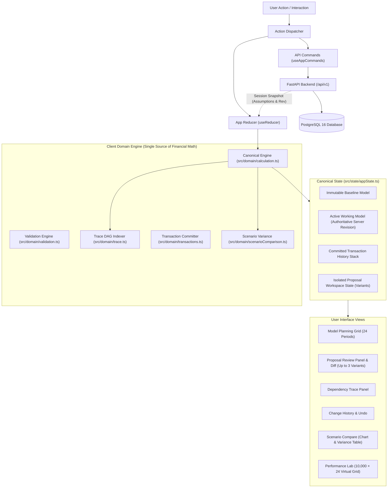
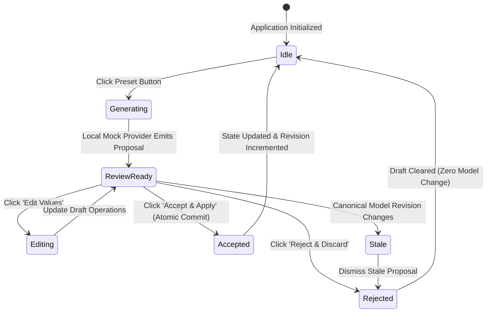

# Model Change Review Lab

> **Notice:** This project is an independent engineering prototype developed as a proof of concept. It has **no official affiliation with Drivetrain AI**, uses **100% synthetic financial data**, and simulates AI proposals using a deterministic local provider with **zero external AI APIs, LLMs, or network services**.

---

## 1. Project Overview

The **Model Change Review Lab** explores an architectural question in financial planning and business modeling:

> _How can an AI-assisted planning application allow generative suggestions and complex multi-cell scenario updates while preserving strict financial integrity, reviewability, auditability, and mathematical traceability?_

Spreadsheet and FP&A tools traditionally struggle when automation mutates cell values directly without reviewable transaction boundaries. The Model Change Review Lab demonstrates an architectural pattern designed to solve this problem:

1. **Independent Verification & Proposal Lifecycle:** AI outputs are structured _proposals_ (lists of targeted cell operations), never direct mutations. They are previewed in isolation, inspected via clear before/after diffs, edited if necessary, and accepted or rejected by human operators.
2. **Atomic Transaction Commits:** Accepting a proposal commits all operations atomically into the canonical state tree, recording a transactional snapshot with before/after audit records.
3. **Monotonic Revision Safety:** Any concurrent edit, undo, or reset increments the revision token, instantly invalidating stale proposals and preventing accidental overwrites.
4. **DAG Formula Traceability:** Every calculated metric across 24 monthly periods is connected to an explicit directed acyclic graph (DAG) node, enabling users to click any output cell to inspect its exact formula, dependencies, and underlying inputs.
5. **Headless Virtualization & Performance Stress-Testing:** An isolated Performance Lab demonstrates row windowing across a 10,000-row × 24-column dataset (240,000 cells) using `@tanstack/react-virtual`, providing honest, reproducible benchmarks.

---

## 2. Architecture & Data Flow

The application follows a unidirectional data flow separating pure domain logic from React UI components.

### System Architecture Flow

The system uses a full-stack architecture with a strict boundary between persistence and financial mathematics:

- **Browser Client (React 19 + TypeScript):** Owns the single and authoritative financial calculation engine (`calculateModel`), Trace DAG indexer (`buildTraceIndex`), scenario variance comparator, and virtualization lab. Financial formulas are never duplicated on the server.
- **Backend API (FastAPI + Python 3.12):** Authoritatively validates assumption inputs, enforces row-level locking (`SELECT ... FOR UPDATE`), serializes monotonic revision updates, persists proposal workspaces/variants, and logs transaction history.
- **Database (PostgreSQL 16):** Stores hashed capability tokens (`X-Workspace-Token`), session assumptions, active/archived workspaces, and audit transactions with foreign keys and partial unique indexes.

See [`docs/implementation/FULL_STACK_BACKEND_ARCHITECTURE.md`](docs/implementation/FULL_STACK_BACKEND_ARCHITECTURE.md) for full architectural specifications, schema definitions, and concurrency controls.



### Proposal Workflow State Machine



---

## 3. Financial Model Formulas & Invariants

All calculations are executed exclusively by the pure function `calculateModel` in [`src/domain/calculation.ts`](src/domain/calculation.ts). No financial formulas exist in React components.

All monetary values are rounded to two decimal places using `roundMoney(v) = Math.round(v * 100) / 100`.

### Exact Domain Formulas

| Metric                 | Horizon Period  | Formula Specification                               |
| ---------------------- | --------------- | --------------------------------------------------- |
| **Revenue ($)**        | Period $t = 1$  | `roundMoney(startingRevenue * (1 + growthRate[1]))` |
| **Revenue ($)**        | Period $t > 1$  | `roundMoney(revenue[t-1] * (1 + growthRate[t]))`    |
| **Total FTE**          | All periods     | `engineeringFte[t] + otherFte[t]` _(integer)_       |
| **Payroll ($)**        | All periods     | `roundMoney(totalFte[t] * costPerFte[t])`           |
| **Total OpEx ($)**     | All periods     | `roundMoney(payroll[t] + otherOpex[t])`             |
| **EBITDA ($)**         | All periods     | `roundMoney(revenue[t] - totalOpex[t])`             |
| **Ending Cash ($)**    | Period $t = 1$  | `roundMoney(startingCash + ebitda[1])`              |
| **Ending Cash ($)**    | Period $t > 1$  | `roundMoney(endingCash[t-1] + ebitda[t])`           |
| **Cumulative Revenue** | Horizon M01–M24 | `sum(revenue[1] .. revenue[24])`                    |

### Validation Rules

All manual cell edits and proposed operations are validated prior to commit:

| Field                   | Type       | Min Bound       | Max Bound           | Rejection Handling                   |
| ----------------------- | ---------- | --------------- | ------------------- | ------------------------------------ |
| **Starting Revenue**    | Currency   | $0.00           | $1,000,000,000.00   | Rejected with inline error           |
| **Starting Cash**       | Currency   | $0.00           | $1,000,000,000.00   | Rejected with inline error           |
| **Revenue Growth Rate** | Percentage | -50.0% (-0.50)  | +50.0% (+0.50)      | Rejected with inline error           |
| **Engineering FTE**     | Integer    | 0               | 1,000               | Non-integers / out of range rejected |
| **Other FTE**           | Integer    | 0               | 1,000               | Non-integers / out of range rejected |
| **Cost per FTE**        | Currency   | $1.00           | $100,000.00         | Negative / excessive values rejected |
| **Other OpEx**          | Currency   | $0.00           | $1,000,000,000.00   | Negative / excessive values rejected |

---

## 4. Setup, Development & Verification Commands

### Prerequisites

- **Node.js:** v22.x LTS (primary CI and local development)
- **Python:** v3.12.x and `uv` package manager
- **Docker & Docker Compose:** for PostgreSQL 16 container

### 1. Database Setup (PostgreSQL 16)

```bash
# Start PostgreSQL 16 container (bound securely to 127.0.0.1:5432)
docker compose up -d

# Verify database health
docker compose ps
```

### 2. Backend Setup & Verification (FastAPI + SQLAlchemy 2.x)

```bash
cd backend

# Install locked Python dependencies
uv sync --locked

# Apply Alembic database migrations
uv run alembic upgrade head

# Run linter and formatting checks
uv run ruff check app tests
uv run ruff format --check app tests

# Run backend pytest test suite against isolated test database (39 tests)
# Note: pytest requires TEST_DATABASE_URL (defaults to mcrl_test) and fails closed
# if pointed at the application database (mcrl) to prevent accidental truncation.
uv run pytest

cd ..
```

### 3. Frontend Setup & Verification (React 19 + TypeScript)

```bash
# Install frontend dependencies
npm ci

# Typecheck codebase with strict TypeScript
npm run typecheck

# Run ESLint source analysis
npm run lint

# Verify Prettier code formatting
npm run format

# Run full Vitest unit & component test suite (24 suites, 196 tests)
npm test -- --run

# Compile production bundle with backend API target
VITE_API_BASE_URL=http://127.0.0.1:8000 npm run build
```

### 4. End-to-End & Automated Accessibility Testing (Playwright)

```bash
# Run Playwright E2E integration and Axe WCAG 2.2 AA accessibility tests (10 tests)
# (Orchestrates FastAPI backend and Vite preview automatically)
npm run test:e2e
```

### 5. Production Deployment (Microsoft Azure Linux VM + Coolify, Docker Compose)

Model Change Review Lab provides a dedicated containerized production setup:

- **Azure & Coolify Deployment:** Refer to the comprehensive deployment guide in [`docs/DEPLOYMENT.md`](docs/DEPLOYMENT.md) for Ubuntu 24.04 LTS Azure VM provisioning, Network Security Group (NSG) configurations, self-hosted Coolify setup, environment variable matrices, and backup procedures.
- **Docker Compose Production:** `docker compose -f compose.prod.yaml up -d --build` builds the backend container, isolates PostgreSQL inside an internal Docker network (no public port exposure), and auto-applies Alembic migrations on startup.

---

## 6. Performance Lab: Methodology & Benchmarks

The Performance Lab ([`src/features/performance/`](src/features/performance/)) is an isolated module designed to stress-test DOM virtualization using a deterministic **10,000-row × 24-column synthetic dataset (240,000 cells)**.

### Non-Negotiable Invariants

- The synthetic dataset is generated inside the performance feature and is **never passed to `calculateModel`**.
- Measurements are honest: missing or unrun metrics report **"Not measured"**, and failures report **"Unavailable"** (never false `0 ms`).
- Diagnostic targets are reference objectives, not guaranteed thresholds across all hardware.

### Benchmark Definitions & Verification

The Performance Lab validates the structural scalability of the virtualized grid and provides runtime diagnostic metrics:

| Metric                           | Target (Diagnostic) | Verified Assertion                            | Measurement Methodology                                                                                                                          |
| -------------------------------- | ------------------- | --------------------------------------------- | ------------------------------------------------------------------------------------------------------------------------------------------------ |
| **Dataset Generation**           | Diagnostic          | In-memory benchmark                           | Pure in-memory generation of 10,000 × 24 numbers via `performance.now()`. Kept completely separate from React layout/render cycles.              |
| **Time to Grid Ready**           | `< 500 ms`          | Target objective                              | Measured from the user's "Run Benchmark" click to the first committed virtual grid layout using `performance.now()` in a `useLayoutEffect` hook. |
| **Mounted Body Rows**            | `< 100 rows`        | **< 100 rows verified (E2E assertion)**        | Querying actual mounted DOM elements (`[data-virtual-row="true"]`). Proves that only the visible viewport window + overscan is mounted.          |
| **Canonical Model Recompute**    | `< 10 ms`           | Target objective                              | Direct invocation of `calculateModel(seedAssumptions)` across 24 periods. Pure calculation duration separate from React state updates.           |
| **Edit Input-to-Commit Latency** | p95 `< 100 ms`      | Target objective                              | Diagnostic measurement from cell edit event to committed layout state across real synthetic cell edit iterations.                                |

> **Measurement Note:** Edit latency is labeled as **input-to-commit latency** (measured to React commit/layout effect). It does not represent full browser frame presentation/paint time. Timings vary by client CPU and browser execution engine; only the structural DOM virtualization row limit (`< 100` mounted rows out of 10,000) is enforced as an automated test invariant.

---

## 7. Accessibility & Responsive Design

- **Zero Axe-core Violations in Listed Automated Test Flows:** Automated Axe-core scans pass with zero violations across all primary routes (Model Grid, Proposal Review, Trace Panel, History, Scenario Compare, Performance Lab). Note: automated scans verify automated rule compliance and do not substitute for a comprehensive manual accessibility review across all WCAG 2.2 criteria.
- **Keyboard Navigation:** Full arrow key navigation across grid cells, `Enter` to edit / trace, `Escape` to cancel, and `Tab` through editable cells.
- **Focus Management:** Focus returns to the invoking control when drawers and confirmation dialogs close.
- **Reduced Motion Support:** `@media (prefers-reduced-motion: reduce)` disables non-essential animations and transitions.
- **Responsive Viewports:** Tested down to 375px mobile viewports with zero page-level horizontal overflow. Complex tables scroll within dedicated containers.

---

## 8. Known Limitations & Prototype Boundaries

1. **Simulated AI Provider:** Change proposals are generated deterministically by local mock templates. No live LLM or external AI API is queried.
2. **Synthetic Data Only:** The baseline figures ($750k starting revenue, $3M cash) and synthetic 10k grid are completely synthetic test fixtures.
3. **Anonymous Bearer Sessions:** Sessions are authenticated via anonymous capability tokens (`X-Workspace-Token`), stored hashed (SHA-256) in PostgreSQL with 30-day inactivity expiration. No confidential user or company data is ever collected or stored.
4. **Diagnostic Benchmarks:** Performance timings depend on the client machine's processor and browser engine and should be interpreted as diagnostic indicators.
