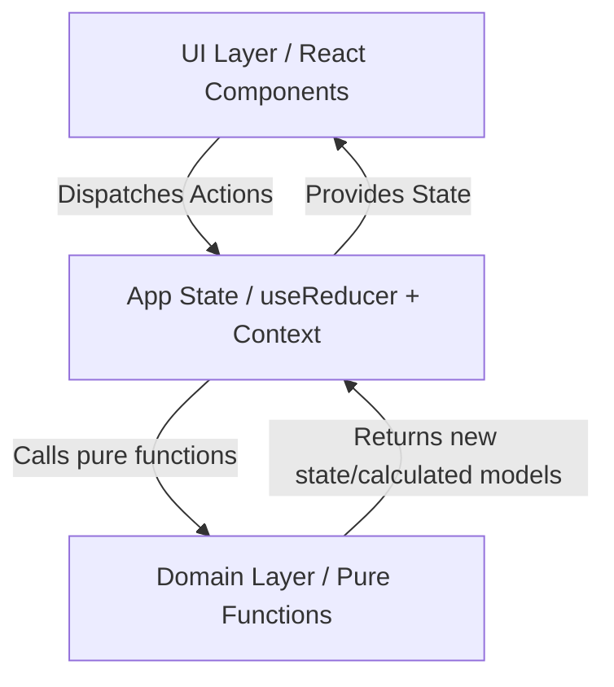
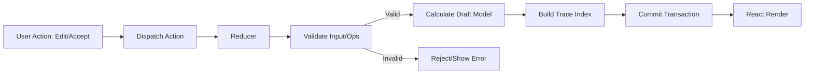
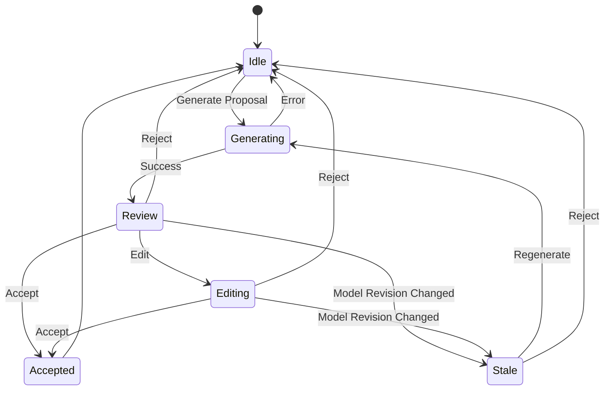
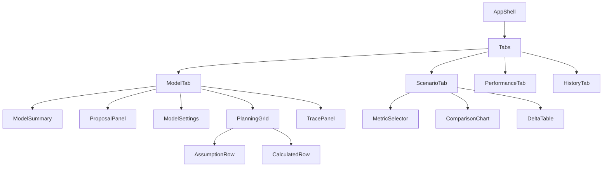
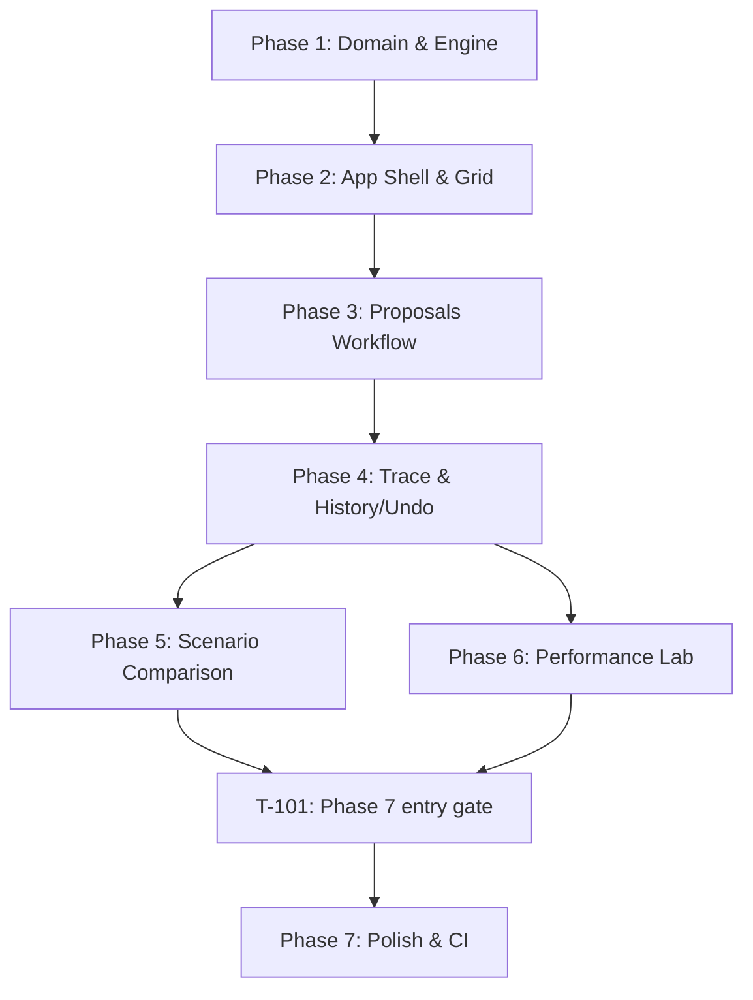

# Implementation Master Plan: Model Change Review Lab

## 1. Executive Summary

**What is being built**: An independent, frontend-focused prototype of a financial planning model (Model Change Review Lab). It demonstrates a deterministic calculation engine, a workflow for reviewing and accepting simulated AI proposals, output-to-input trace capabilities, and scenario comparison, all stress-tested by a large virtualized grid.
**Why**: To demonstrate complex data visualization, spreadsheet-inspired UI modeling, strict state correctness, performance optimization (virtualization), and accessible frontend engineering, explicitly as a proof-of-impact prototype.
**Constraints**: 
- No backend, no database, no real AI/LLMs.
- Repository status to be verified in Phase 0; not assumed greenfield.
- Strict stack: Vite + React 19 + TypeScript 5.7 (strict) + Tailwind CSS 4 + shadcn/ui (versions provisional until Phase 0 lockfile inspection).
- Purely deterministic local calculations.
- No external APIs or Drivetrain affiliations.

## 2. Architecture Overview

### Overall System Architecture


### Data Flow Diagram


### Proposal Workflow State Machine


### Component Hierarchy


## 3. Domain Layer Design

### Type Definitions

```typescript
type PeriodIndex = 1 | 2 | 3 | 4 | 5 | 6 | 7 | 8 | 9 | 10 | 11 | 12 | 13 | 14 | 15 | 16 | 17 | 18 | 19 | 20 | 21 | 22 | 23 | 24;

interface MonthAssumptions {
  period: PeriodIndex;
  revenueGrowthRate: number;
  engineeringFte: number;
  otherFte: number;
  loadedMonthlyCostPerFteUsd: number;
  otherOperatingExpenseUsd: number;
}

interface ModelAssumptions {
  startingRevenueUsd: number;
  startingCashUsd: number;
  months: MonthAssumptions[]; // Exactly 24
}

interface MonthCalculated {
  period: PeriodIndex;
  revenue: number;
  totalFte: number;
  payroll: number;
  totalOperatingExpense: number;
  ebitda: number;
  endingCash: number;
}

interface CalculatedModel {
  months: MonthCalculated[]; // Exactly 24
  summaryMetrics: {
    m24Revenue: number;
    m24Ebitda: number;
    m24EndingCash: number;
  };
}

type CellId = 
  | `setting:${keyof Pick<ModelAssumptions, 'startingRevenueUsd' | 'startingCashUsd'>}`
  | `assumption:${keyof Omit<MonthAssumptions, 'period'>}:M${string}`
  | `calculated:${keyof Omit<MonthCalculated, 'period'>}:M${string}`;

interface TraceNode {
  id: CellId;
  kind: 'setting' | 'assumption' | 'calculated';
  label: string;
  period: PeriodIndex | null;
  value: number;
  unit: string;
  formulaLabel?: string;
  inputIds: CellId[];
}

interface TraceIndex {
  nodes: Record<CellId, TraceNode>;
}

interface ProposalOperation {
  targetKey: string;
  targetPeriod: PeriodIndex | null;
  previousValue: number;
  proposedValue: number;
  displayUnit: 'usd' | 'fte' | 'percent';
  changeLabel: string;
}

interface ChangeProposal {
  id: string;
  templateId: string;
  title: string;
  rationale: string;
  baseRevision: number;
  operations: ProposalOperation[];
}

type ProposalStatus = 'idle' | 'generating' | 'review' | 'editing' | 'stale';

interface TransactionRecord {
  id: string;
  kind: 'manual-edit' | 'proposal-accepted';
  description: string;
  previousAssumptions: ModelAssumptions;
  nextAssumptions: ModelAssumptions;
  affectedCells: CellId[];
  timestamp: number;
}

interface ValidationError {
  cellId?: CellId;
  message: string;
}

interface ValidationResult {
  isValid: boolean;
  errors: ValidationError[];
}

interface MetricDelta {
  period: PeriodIndex;
  baselineValue: number;
  workingValue: number;
  absoluteDelta: number;
  percentageDelta: number | null;
}

interface ScenarioComparison {
  metric: 'revenue' | 'ebitda' | 'endingCash';
  deltas: MetricDelta[];
  cumulativeBaseline: number;
  cumulativeWorking: number;
}
```

### Exact Formulas (Pseudocode)
- `roundMoney(val)`: `Math.round(val * 100) / 100`
- Revenue M01: `roundMoney(startingRevenue * (1 + growthRate[1]))`
- Revenue Mt>1: `roundMoney(revenue[t-1] * (1 + growthRate[t]))`
- Total FTE: `engineeringFte[t] + otherFte[t]`
- Payroll: `roundMoney(totalFte[t] * loadedMonthlyCostPerFteUsd[t])`
- TotalOpex: `roundMoney(payroll[t] + otherOperatingExpenseUsd[t])`
- EBITDA: `roundMoney(revenue[t] - totalOpex[t])`
- EndingCash M01: `roundMoney(startingCash + ebitda[1])`
- EndingCash Mt>1: `roundMoney(endingCash[t-1] + ebitda[t])`

### Validation Rules Table

| Field | Type | Min | Max | Rejection |
|-------|------|-----|-----|-----------|
| `startingRevenueUsd` | Finite number | 0 | 1,000,000,000 | Reject edit, show field msg |
| `startingCashUsd` | Finite number | 0 | 1,000,000,000 | Reject edit, show field msg |
| `revenueGrowthRate` | Finite number | -0.5 | +0.5 | Reject edit, show field msg |
| FTE fields (`engineeringFte`, `otherFte`) | Integer | 0 | 1,000 | Reject decimals, text, out of range |
| `loadedMonthlyCostPerFteUsd` | Finite number | 1 | 100,000 | Reject edit, show field msg |
| `otherOperatingExpenseUsd` | Finite number | 0 | 1,000,000,000 | Reject edit, show field msg |

### Seed Data Values
- `startingRevenueUsd`: 750,000
- `startingCashUsd`: 3,000,000
- `revenueGrowthRate`: 0.025 (all months)
- `loadedMonthlyCostPerFteUsd`: 12,000 (all months)
- `otherOperatingExpenseUsd`: 240,000 (all months)
- `engineeringFte`: M01-M06=12; M07-M12=14; M13-M18=16; M19-M24=18
- `otherFte`: M01-M06=18; M07-M12=20; M13-M18=22; M19-M24=24

### Preset Proposal Templates
1. **hire-engineers-from-q3**: Add 2 to `engineeringFte` from M07 to M24.
2. **increase-growth-from-q3**: Add 0.01 to `revenueGrowthRate` from M07 to M24.
3. **reduce-opex-from-m04**: Set `otherOperatingExpenseUsd` to `roundMoney(val * 0.92)` from M04 to M24.

### Transaction Commit Algorithm (8-step)
1. Validate requested value/operations.
2. Verify proposal's base revision matches current revision.
3. Apply operations to draft.
4. Verify shape/assumptions.
5. Calculate all derived outputs from draft.
6. Build/validate trace metadata.
7. If any fail: discard draft, leave canonical state, show error.
8. If pass: commit assumptions/derived result, add history snapshot, increment revision, clear proposal.

### Stale Proposal & Undo Semantics
- **Stale**: If a proposal is pending and the `working.revision` changes (due to edit, undo, or accept), the proposal becomes stale.
- **Undo**: Single-level (or history based). Removes latest transaction, restores previous `workingAssumptions` from snapshot, increments `revision` (to invalidate pending proposals), and recomputes.

## 4. Application State Management

```typescript
interface AppState {
  baselineAssumptions: ModelAssumptions;
  workingAssumptions: ModelAssumptions;
  workingRevision: number;
  calculatedModel: CalculatedModel;
  traceIndex: TraceIndex;
  
  transactions: TransactionRecord[];
  
  ui: {
    activeTab: 'model' | 'scenario' | 'performance' | 'history';
    proposalState: {
      status: ProposalStatus;
      proposal: ChangeProposal | null;
      editedOperations: ProposalOperation[] | null;
    };
    editingCell: CellId | null;
    selectedTraceCell: CellId | null;
  }
}
```
**Reducer Actions**:
- `DIRECT_EDIT_COMMIT`: Validates and commits a manual cell edit.
- `DIRECT_EDIT_CANCEL`: Clears UI edit state.
- `PROPOSAL_GENERATE`: Starts simulated generation.
- `PROPOSAL_EDIT_OPERATION`: Updates draft proposal ops.
- `PROPOSAL_ACCEPT`: Commits proposal.
- `PROPOSAL_REJECT`: Discards proposal.
- `UNDO_LAST_TRANSACTION`: Reverts last commit.
- `RESET_WORKING_SCENARIO`: Resets working to baseline.
- `SET_ACTIVE_TAB`, `SET_EDITING_CELL`, `SET_SELECTED_TRACE_CELL`: UI navigation.

**Derivation Strategy**: `calculatedModel` and `traceIndex` are recomputed purely in the reducer when assumptions change. React components strictly read these pre-calculated values.

## 4. Phase 0 — Reconnaissance (Mandatory)

Before any implementation task, complete Phase 0:
- Inspect repository status (`git status`, directory listing).
- Read package manager and lockfile; document current versions.
- Review existing framework, dependencies, scripts, config, components, styling, chart/grid libraries, tests, CI/deployment.
- Produce `docs/reconnaissance.md`: repository status, dependency list, framework version, recommended structure (build on existing / replace with Vite / greenfield), and any blockers.
- **Do not modify application code or install dependencies during Phase 0.**
- Wait for explicit human approval of the reconnaissance report before Phase 1 begins.
- Only scaffold Vite if the repo is confirmed empty (observation, not assumption) and the user approves replacing/creating structure.
- Preserve existing package manager unless user explicitly approves a change.
- Do not claim repository is empty if it is inaccessible; report the blocker.
- Make approval enforceable: no implementation task may reference an unapproved/absent reconnaissance report.

## 5. Source Tree

```text
src/
├── domain/
│   ├── types.ts
│   ├── seed.ts
│   ├── calculation.ts       # Sole financial calculation engine
│   ├── validation.ts
│   ├── trace.ts             # Pure trace-index builder
│   ├── transactions.ts      # Atomic transaction logic
│   ├── proposals.ts         # Deterministic mock proposal templates
│   ├── operations.ts        # Pure cloned-draft operation application
│   ├── scenarioComparison.ts
│   ├── formatting.ts        # Centralized Intl.NumberFormat wrappers
│   └── __tests__/
├── state/
│   ├── appState.ts
│   ├── appReducer.ts
│   ├── AppProvider.tsx
│   └── actions.ts
├── pages/
│   ├── ModelPage.tsx
│   └── ScenarioPage.tsx
├── lib/
│   └── utils.ts
├── components/
│   ├── ui/
│   │   ├── Button.tsx
│   │   └── StatusBadge.tsx
│   ├── app/
│   │   ├── MetricValue.tsx
│   │   └── InlineNotice.tsx
│   ├── shell/
│   │   ├── AppShell.tsx
│   │   └── SidePanel.tsx
│   ├── model/
│   │   ├── ModelGrid.tsx
│   │   ├── ModelSettings.tsx
│   │   ├── EditableAssumptionCell.tsx
│   │   ├── CalculatedCell.tsx
│   │   └── gridKeyboard.ts
│   ├── proposals/
│   │   ├── ProposalPromptSelector.tsx
│   │   ├── ProposalReviewPanel.tsx
│   │   ├── ProposalDiff.tsx
│   │   └── ProposalPreviewKPIs.tsx
│   ├── trace/
│   │   └── TraceNodeList.tsx
│   ├── scenario/
│   │   ├── MetricSelector.tsx
│   │   ├── ScenarioChart.tsx
│   │   ├── ScenarioDeltaTable.tsx
│   │   └── ScenarioSummaryCards.tsx
│   ├── performance/
│   │   ├── LabMetricsBanner.tsx
│   │   └── EnvironmentInfo.tsx
│   └── history/
│       ├── HistoryPanel.tsx
│       └── ResetDialog.tsx
├── features/
│   ├── trace/
│   │   └── TracePanel.tsx
│   └── performance/
│       ├── SyntheticDataset.ts
│       ├── VirtualGrid.tsx
│       ├── performanceMeasurements.ts
│       └── PerformanceLabPage.tsx
├── utils/
│   └── math.ts              # roundMoney helper only
├── index.css
└── App.tsx

e2e/
├── critical-journey.spec.ts
└── a11y.spec.ts
```

## 6. Dependency Matrix

| Dependency | Version | Class | Purpose | Notes |
|------------|---------|-------|---------|-------|
| `react` / `react-dom` | 19.3.0 (provisional) | Required | Core UI | Strict mode required; verify against lockfile in Phase 0 |
| `vite` | 8.3.4 (provisional) | Required | Build tool | Verify during Phase 0 |
| `typescript` | 5.7.0 (provisional) | Required | Type checking | Strict enabled |
| `tailwindcss` | 4.3.3 (provisional) | Required | Styling | `@tailwindcss/vite` plugin; verify current docs in Phase 0 |
| `lucide-react` | Latest | Recommended | Icons | |
| `recharts` | 3.10.1 | Required | Scenario charts | Needs `react-is ^19.0.0` override |
| `@tanstack/react-virtual` | 3.14.14 | Required | Perf Lab virtual grid | Used only in Performance Lab |
| `vitest` / `@testing-library/*` | 5.0.3 / 16.3.3 | Required | Testing | |

## 7. Phase Dependency Graph



## 8. Implementation Phases

### Source Tree Deviation Note (PRD §15.3 illustrative; adopted tree documented)
- The PRD §15.3 proposes an illustrative tree using `src/app/`, `src/domain/modelTypes.ts`, `src/domain/seedModel.ts`, `src/domain/calculations.ts`, `src/domain/transactions.ts`, `src/domain/formatting.ts`, `src/features/` for UI, and `src/components/` for primitives.
- The adopted canonical tree (used consistently across this plan and all task/module references) uses `src/domain/` for pure types, seed, calculation, validation, trace, transaction, proposal-operation, scenario-comparison and formatting functions; `src/state/` for reducer/provider state; `src/components/` for UI primitives and model/proposal/scenario/history components; and `src/features/trace/` plus `src/features/performance/` for their feature pages and panels. The exact adopted paths are listed in the tree above.
- Rationale: The PRD explicitly states (§28.1, §15.3 introduction) that stack/tree choices are independent implementation decisions, not reconstructions of an internal product; modern Vite/React conventions favor `src/` prefixed flat structures; consistency with already-corrected task/module paths is more valuable than reverting to an illustrative draft.
- Impact: Module ownership unchanged (domain pure, state React, components UI); formulas still only in `calculation.ts`; formatting centralized in `formatting.ts`; trace engine separate from panel; no PRD-required functionality lost.
- Approval required: Only if a reviewer requires exact PRD file names over consistency; currently no blocker because PRD does not bind file names.

### Phase 1: Domain Core
- **Objective**: Build the pure calculation engine (`src/domain/calculation.ts`), validation (`validation.ts`), trace index (`trace.ts`), canonical transaction pathway (`transactions.ts`), proposal provider (`proposals.ts`), proposal-operation draft helper (`operations.ts`), pure scenario-comparison helper (`scenarioComparison.ts`), seed (`seed.ts`), types (`types.ts`), and utilities (`src/utils/math.ts`, `src/domain/formatting.ts`). Domain logic stays independent of React/browser (NFR-001); all financial formulas live in `calculation.ts`; all canonical state changes use the transaction/reducer pathway. Scenario-comparison calculations and unit tests are P1 domain work (T-016/T-022); chart/table UI remains P5.
- **PRD**: §6.1-6.9, §9.1-9.3, §10.1-10.2
- **Files**: `src/domain/*.ts`, `src/domain/formatting.ts`, `src/utils/math.ts`, `src/domain/__tests__/*.test.ts`
- **Tasks**:
  1. Scaffold Vite project.
  2. Write types in `types.ts`.
  3. Implement `seed.ts` (fixture data).
  4. Implement `calculation.ts` (roundMoney, calculateModel).
  5. Implement `validation.ts`.
  6. Implement `trace.ts`.
  7. Implement `transactions.ts` and the pure proposal-operation helper (`operations.ts`).
  8. Implement `scenarioComparison.ts` and its pure delta/cumulative calculations (T-016).
  9. Write Vitest unit tests for calculations, scenario comparison (T-022), validation and immutability, ensuring exact formula matches.
- **Tests**: Formula exactness, validation bounds, immutability.
- **Commands**: `[package-manager] create vite`, `[package-manager] test`
- **Exclusions**: No UI code.

### Phase 2: App Shell & Grid Edit Flow
- **Objective**: Implement app reducer, basic tabs, model grid UI, keyboard editing, manual commit.
- **PRD**: §7.1-7.4, §8.1, §8.3-8.4
- **Files**: `src/state/*`, `src/components/shell/*`, `src/components/model/ModelGrid.tsx`, `EditableAssumptionCell.tsx`
- **Tasks**:
  1. Create `appReducer.ts` for canonical vs UI state.
  2. Build `AppProvider`.
  3. Implement App layout with tabs.
  4. Render ModelGrid with 5 assumption rows and 6 calculated rows.
  5. Implement keyboard nav and inline edit.
  6. Dispatch `DIRECT_EDIT_COMMIT`.
- **Tests**: Reducer tests, component keyboard tests.
- **Verify**: Can type in cell, press Enter, validate, and see downstream update.

### Phase 3: Proposal Workflow
- **Objective**: Implement MockProposalProvider, 3 templates, review panel, diff view, accept/reject, stale protection.
- **PRD**: §6.6-6.8, §7.5-7.6, §8.2
- **Files**: `src/domain/proposals.ts`, `src/domain/operations.ts`, `src/components/proposals/*`
- **Tasks**:
  1. Add provider interface and 3 preset logic.
  2. Build UI to select a template.
  3. Show diffs/previews using cloned draft engine calculation.
  4. Handle Accept (atomic commit) and Reject.
  5. Implement stale logic (disable Accept if revision mismatch).
- **Verify**: Generate proposal -> Edit cell (becomes stale) -> Reject. Generate -> Accept -> updates grid.

### Phase 4: Trace Panel & Undo History
- **Objective**: Implement trace inspector for calculated outputs, transaction history log, single-level undo, reset to baseline.
- **PRD**: §7.7, §7.9, §8.5
- **Files**: `src/features/trace/TracePanel.tsx`, `src/components/trace/TraceNodeList.tsx`, `src/components/history/HistoryPanel.tsx`, `src/components/history/ResetDialog.tsx`, `src/domain/transactions.ts`, `src/state/appReducer.ts`
- **Tasks**:
  1. Make read-only cells selectable to open TracePanel.
  2. Display dependencies from `TraceIndex`.
  3. Show list of committed transactions in HistoryPanel.
  4. Implement `UNDO_LAST_TRANSACTION` reducer logic.
  5. Implement `RESET_TO_BASELINE` in the reducer/transaction pathway and wire the confirmation-only `ResetDialog`; T-064 covers revision advancement.
- **Verify**: Select EBITDA cell, trace dependencies to Revenue and Opex. Undo reverts last proposal.

### Phase 5: Scenario Comparison
- **Objective**: Baseline vs Working chart (Recharts) and delta table.
- **PRD**: §7.8
- **Files**: `src/domain/scenarioComparison.ts` (pure logic already covered in P1), `src/components/scenario/*` (P5 UI only)
- **Tasks**:
  1. Calculate deltas for Revenue, EBITDA, Cash.
  2. Render Recharts Line Chart.
  3. Render accessible data table with absolute/percentage deltas.
- **Verify**: Changes in Model tab reflect immediately in Scenario tab against fixed baseline.

### Phase 6: Performance Lab
- **Objective**: 10,000 x 24 synthetic grid using virtualizer, isolated from canonical state.
- **PRD**: §7.10
- **Files**: `src/features/performance/*`, `src/components/performance/LabMetricsBanner.tsx`, `src/components/performance/EnvironmentInfo.tsx`
- **Tasks**:
  1. Generate 10k deterministic rows.
  2. Use `@tanstack/react-virtual` for row virtualization.
  3. Implement sparse override map for 1 editable cell to measure latency.
  4. Show measurement metrics.
- **Verify**: Scrolling is smooth. DOM element count is bounded (< 100 rows).

### Phase 7: Polish & CI
- **Objective**: Accessibility, responsiveness, E2E/Playwright, README documentation.
- **Phase entry gate**: Complete T-101, which requires successful P5 verification (T-077) and P6 verification (T-089), before starting any Phase 7 task.
- **PRD**: §5 (FR-022 - FR-027, NFR-004)
- **Files**: `README.md`, `.github/workflows/ci.yml`, `e2e/*.spec.ts`
- **Tasks**:
  1. Accessibility audit (axe-core).
  2. CSS adjustments for mobile.
  3. Write Playwright E2E covering main 90-second workflow.
  4. Fill out detailed README.
- **Verify**: CI green. No external API calls via network tab.

## 9. Parallelization Opportunities
- **Phase 5 (Scenario)** and **Phase 6 (Performance Lab)** can be developed in parallel, as they do not depend on each other and only read from the state/domain completed in Phase 4.
- Within Phase 1, `calculation.ts` and `validation.ts` can be parallelized.

## 10. Coding Agent Execution Protocol Summary
1. **Adhere to Invariants**: Strict domain calculations. No real AI. Synthetic data only.
2. **Phase Order Strictly Enforced**: Do not build UI (Phase 2+) until Domain tests (Phase 1) are green. Before Phase 7 work, complete T-101, which requires both P5 (T-077) and P6 (T-089) verification. P5 and P6 may run in parallel after P4 passes.
3. **Purity**: Domain layer must be free of React/DOM dependencies.
4. **No Premature Optimization**: Except for Phase 6 Performance Lab, use straightforward React state. Memoize derived data appropriately.
5. **Report & Adapt**: If a requirement causes an internal contradiction, explicitly flag it in thought/plan before proceeding.