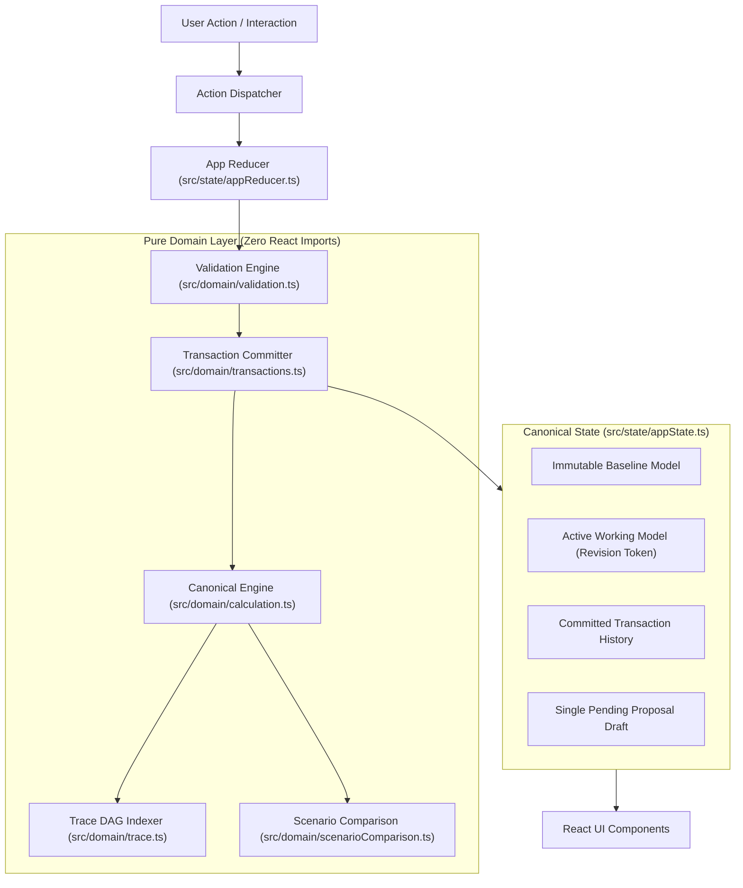
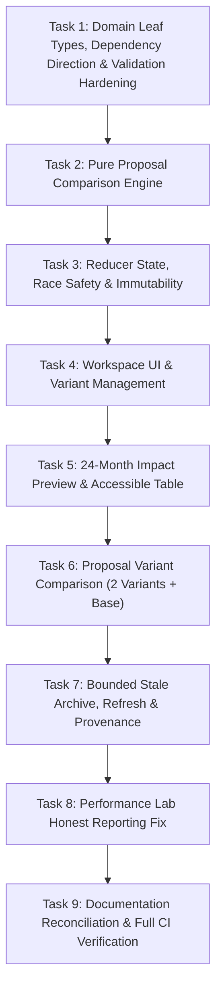

# Implementation Plan: Model Change Review Lab V2

---

## 1. Executive Recommendation

### Smallest Safe Implementation Sequence
The V2 initiative can be delivered safely by extending the existing in-memory architecture without rewriting the calculation engine, introducing external state libraries, or disturbing verified baseline behavior. The minimal implementation sequence consists of **nine sequential tasks**:

1. **Task 1 (Domain Leaf Types, Dependency Direction & Validator Hardening):** 
   * Define foundational domain types in [`src/domain/types.ts`](file:///home/satjeet/Desktop/drive/src/domain/types.ts), including `ProposalTemplateId` (moved from `proposals.ts` so `types.ts` remains a strict leaf with zero internal domain imports), `ProposalVariant`, `ProposalWorkspace`, and `TransactionProvenance`.
   * Harden [`src/domain/validation.ts`](file:///home/satjeet/Desktop/drive/src/domain/validation.ts) with strict operation metadata cross-checking (target key, period, cell ID syntax, display unit match, and mandatory base value verification).
2. **Task 2 (Pure Proposal Comparison Engine):** 
   * Implement a pure, side-effect-free comparison helper in [`src/domain/proposalComparison.ts`](file:///home/satjeet/Desktop/drive/src/domain/proposalComparison.ts) that consumes the immutable workspace base snapshot and one or two variant models, producing uniform 24-month horizon deltas for chart and table rendering without React dependencies.
3. **Task 3 (Workspace State, Async Race Safety & Immutability):** 
   * Extend [`src/state/appState.ts`](file:///home/satjeet/Desktop/drive/src/state/appState.ts) and [`src/state/appReducer.ts`](file:///home/satjeet/Desktop/drive/src/state/appReducer.ts) to transition from a single `pendingProposal` to a managed `proposalWorkspace` (holding up to 3 variants: 1 original + 2 duplicates, unique instance IDs, independent operations, immutable reset snapshots, and a bounded session archive of up to 3 stale workspaces).
   * Guarantee async race safety via correlation `requestId` tokens on both success and error actions; bind generation strictly to request-time snapshots.
   * Enforce no-op proposal rejection: block acceptance if all proposed values equal base values, preventing phantom transactions and artificial revision advancement.
4. **Task 4 (Workspace UI & Variant Lifecycle):** 
   * Update [`src/components/proposals/ProposalPromptSelector.tsx`](file:///home/satjeet/Desktop/drive/src/components/proposals/ProposalPromptSelector.tsx), [`src/components/proposals/ProposalReviewPanel.tsx`](file:///home/satjeet/Desktop/drive/src/components/proposals/ProposalReviewPanel.tsx), and [`src/components/proposals/ProposalDiff.tsx`](file:///home/satjeet/Desktop/drive/src/components/proposals/ProposalDiff.tsx) to support variant selection, duplication (capped at 3), per-variant reset-to-creation, inline validation error retention, no-op indicator badges, and removal of duplicate variants.
5. **Task 5 (Full-Horizon Preview & Accessible Table):** 
   * Introduce a unified Proposal Impact visualization displaying 24-month base vs. proposed values with Recharts and an accessible data table. 
   * **Stale Preview Rule:** Disable preview chart and table entirely when the proposal is stale (`workspace.baseRevision !== state.revision`); display an explicit notice requiring fresh generation.
   * Add ending-cash disclosure caption to Proposal Preview and Scenario Compare without modifying Scenario Compare calculations.
6. **Task 6 (Proposal Variant Comparison — 2 Variants + Base):** 
   * Add variant comparison mode (maximum 3 plotted series: Base + Variant A + Variant B) comparing alternatives against their shared base. Keep the existing [`ScenarioPage`](file:///home/satjeet/Desktop/drive/src/pages/ScenarioPage.tsx) calculation engine strictly untouched.
7. **Task 7 (Bounded Stale Archive, Refresh & Transaction Provenance):** 
   * Implement explicit "Create fresh version" action that orchestrates a new generation against current working assumptions and revision, while appending the superseded workspace to a bounded FIFO list of up to 3 archived stale drafts.
   * Wire typed provenance to [`TransactionRecord`](file:///home/satjeet/Desktop/drive/src/domain/types.ts#L123-L132) and display it in [`src/components/history/HistoryPanel.tsx`](file:///home/satjeet/Desktop/drive/src/components/history/HistoryPanel.tsx).
   * Clarify undo semantics: undo restores prior assumptions while revision token monotonically increments (`state.revision + 1`).
8. **Task 8 (Performance Lab Honest Reporting & Rerun Fix):** 
   * Correct Performance Lab measurement reporting in [`src/features/performance/PerformanceLabPage.tsx`](file:///home/satjeet/Desktop/drive/src/features/performance/PerformanceLabPage.tsx) and [`src/features/performance/VirtualGrid.tsx`](file:///home/satjeet/Desktop/drive/src/features/performance/VirtualGrid.tsx) by separating in-memory assignment timings from user input duration, resetting grid-ready measurement on rerun, and removing floored/combined sample distortions.
9. **Task 9 (Documentation Reconciliation & Full Verification Suite):** 
   * Align [`README.md`](file:///home/satjeet/Desktop/drive/README.md) validation bounds and Node environment documentation.
   * Add superseded historical notice to [`docs/reconnaissance.md`](file:///home/satjeet/Desktop/drive/docs/reconnaissance.md).
   * Execute full verification suite: Vitest domain/lifecycle tests, Playwright critical E2E journey, and Axe automated accessibility scans with explicit keyboard/focus checks.

### High-Level Risks & Mitigations
* **Comparison Conflation:** Conflating the three comparison horizons (Proposal impact preview vs. Proposal variant comparison vs. Existing seed baseline comparison). These remain strictly distinct in data source, labels, and UI locations.
* **State Reference Leaks:** Mutating shared base assumptions or sibling variant operations in memory. Mitigated via deep-readonly TypeScript definitions, pure clone helpers (`cloneModelAssumptions`, `cloneProposalOperations`), and sibling isolation tests.
* **Asynchronous Generation Races:** Model advancing or preset switching while an async generation request is in flight. Mitigated by binding generation to request-time snapshots and validating correlation IDs before committing state.
* **Stale Rebase Misrepresentation:** Attempting arbitrary automatic 3-way rebasing of custom user edits across model revisions. Stale preview is disabled; regeneration is strictly template-driven, explicit, and preserves old drafts in a bounded archive.

### Realistic Stop Condition
* **STOP IMMEDIATELY after submitting this planning artifact.** Do not create, modify, or delete any source files, configuration files, test files, or documentation files without explicit human approval.

### Priorities
* **Must Be Done First:** Domain validation hardening & type circular dependency resolution (Task 1), reducer invariants & race protection (Task 3), and math calculation purity (Task 2).
* **Can Be Deferred (P2 Scope):** Trace dependency deep-linking from proposal diffs, custom variant renaming beyond distinct generated labels, and additional KPI metrics beyond Revenue, EBITDA, and Ending Cash.

---

## 2. Current Repository Snapshot & Investigation Record

### 2.1 Directly Observed Source Facts
* **Repository Remote:** `push-repo` (`https://Satjeet2005@github.com/Satjeet2005/model-change-review-lab.git`).
* **Branch:** `master` (synchronized with `push-repo/master`).
* **Current HEAD Commit SHA:** `af1e6ce44395d0f73643bb670776ba70b38d92da` (`ci: add netlify.toml configuration for build and SPA routing`).
* **Working Tree Status:** 
  * Tracked files: **Clean** (0 modified, 0 staged).
  * Untracked files: **1 file** (`docs/PRD/Model_Change_Review_Lab_V2_PRD.md`, intentionally preserved uncommitted per prompt instructions).
* **Parent Specification Status:** `docs/PRD/Model_Change_Review_Lab_PRD_v1.1_Extended.md` **was found and read in full** (2,312 lines, 151,585 bytes). It details the original v1.0 specifications, the 12 core invariants, and historical phases 0–7.
* **Recent Commit Log:**
  * `af1e6ce` (HEAD -> master, push-repo/master) ci: add netlify.toml configuration for build and SPA routing
  * `bc7671a` docs: move PRD specification to docs/PRD directory
  * `15d9874` phase-7: polish accessibility docs and CI
  * `80d08e6` phase-6: performance lab and honest benchmarks (T-078 through T-089)
  * `cfbcac9` phase-5: scenario comparison (T-068 through T-077)

### 2.2 Command-Verified Results (Local Workstation)
* **Node.js Runtime:** `v24.11.1` (verified via `node -v`).
* **npm Runtime:** `11.6.2` (verified via `npm -v`).
* **Vitest Suite:** 20 test files, 114 tests, **all 114 passed** in 8.87s (`npm test -- --run`).
* **TypeScript Compiler:** Strict typecheck passed with **0 errors** (`npm run typecheck` / `tsc -b`).
* **ESLint:** Linter passed with **0 warnings / 0 errors** (`npm run lint` / `eslint src`).
* **Production Build:** Vite production bundle compilation **succeeded** in 2.52s (`npm run build`).

### 2.3 Configuration-Derived Facts
* **GitHub Actions CI:** Configured to run on **Node 22** ([`.github/workflows/ci.yml` L26](file:///home/satjeet/Desktop/drive/.github/workflows/ci.yml#L26): `node-version: 22`).
* **Netlify Production Host:** Configured to build on **Node 20** ([`netlify.toml` L6](file:///home/satjeet/Desktop/drive/netlify.toml#L6): `NODE_VERSION = "20"`).
* **Reconciliation Finding:** CI enforces Node 22; Netlify specifies Node 20; the local machine runs Node 24.11.1. The plan documents Node 22 as the primary CI testing baseline and Node 20 as the Netlify target, without making unverified assertions about other Node versions.

### 2.4 Prior Audit Reports
* **External Source Audit:** Contained in `docs/PRD/Model_Change_Review_Lab_V2_PRD.md` (based on remote commit `af1e6ce4...`). All findings were cross-checked directly against checkout source code and are summarized in Section 4.

---

## 3. Architecture as it Exists Today

The application follows a unidirectional data architecture strictly separating pure domain calculations from React rendering.



### Exact Component & File Mapping

1. **Data Types and Calculation Pipeline:**
   * [`ModelAssumptions`](file:///home/satjeet/Desktop/drive/src/domain/types.ts#L41-L45), [`MonthAssumptions`](file:///home/satjeet/Desktop/drive/src/domain/types.ts#L32-L39), [`CalculatedModel`](file:///home/satjeet/Desktop/drive/src/domain/types.ts#L67-L70), and [`CellId`](file:///home/satjeet/Desktop/drive/src/domain/types.ts#L78-L82) defined in [`src/domain/types.ts`](file:///home/satjeet/Desktop/drive/src/domain/types.ts).
   * Pure calculation engine: [`calculateModel(assumptions)`](file:///home/satjeet/Desktop/drive/src/domain/calculation.ts#L24-L111) in [`src/domain/calculation.ts`](file:///home/satjeet/Desktop/drive/src/domain/calculation.ts).
   * Deterministic seed baseline: [`createSeedAssumptions()`](file:///home/satjeet/Desktop/drive/src/domain/seed.ts#L8-L47) in [`src/domain/seed.ts`](file:///home/satjeet/Desktop/drive/src/domain/seed.ts).
   * Monetary and delta formatting: [`formatCurrency`](file:///home/satjeet/Desktop/drive/src/domain/formatting.ts#L34-L43), [`formatPercentage`](file:///home/satjeet/Desktop/drive/src/domain/formatting.ts#L49-L54), and [`formatDelta`](file:///home/satjeet/Desktop/drive/src/domain/formatting.ts#L70-L85) in [`src/domain/formatting.ts`](file:///home/satjeet/Desktop/drive/src/domain/formatting.ts).

2. **Proposal Lifecycle (Generation, Edit, Preview, Accept, Reject):**
   * Deterministic mock generator: [`MockProposalProvider`](file:///home/satjeet/Desktop/drive/src/domain/proposals.ts#L58-L177) in [`src/domain/proposals.ts`](file:///home/satjeet/Desktop/drive/src/domain/proposals.ts) emits [`ChangeProposal`](file:///home/satjeet/Desktop/drive/src/domain/types.ts#L112-L119) with IDs matching template IDs (`'hire-engineers-from-q3'`, etc.).
   * Generation trigger: [`ProposalPromptSelector`](file:///home/satjeet/Desktop/drive/src/components/proposals/ProposalPromptSelector.tsx#L10-L90) dispatches `PROPOSAL_GENERATE_START` and `PROPOSAL_GENERATE_SUCCESS`.
   * Value editing: [`ProposalDiff`](file:///home/satjeet/Desktop/drive/src/components/proposals/ProposalDiff.tsx#L22-L236) validates input via [`validateAssumptionValue`](file:///home/satjeet/Desktop/drive/src/domain/validation.ts#L11-L148) and dispatches `PROPOSAL_EDIT_OPERATION`.
   * Preview calculation: [`ProposalPreviewKPIs`](file:///home/satjeet/Desktop/drive/src/components/proposals/ProposalPreviewKPIs.tsx#L13-L142) applies draft operations using [`applyOperationsToDraft`](file:///home/satjeet/Desktop/drive/src/domain/operations.ts#L20-L57) directly against current `workingAssumptions` and computes M24 KPI deltas.
   * Review & Decision: [`ProposalReviewPanel`](file:///home/satjeet/Desktop/drive/src/components/proposals/ProposalReviewPanel.tsx#L11-L218) renders diff and preview, dispatches `PROPOSAL_ACCEPT` or `PROPOSAL_REJECT`.

3. **Reducer and Revision Guards:**
   * Handled in [`appReducer`](file:///home/satjeet/Desktop/drive/src/state/appReducer.ts#L80-L380).
   * Stale revision guard in `PROPOSAL_ACCEPT`: checks `state.pendingProposal.baseRevision !== state.revision` (PRD §6.8).
   * Operation validation: calls [`validateOperationSet`](file:///home/satjeet/Desktop/drive/src/domain/validation.ts#L154-L187) prior to commit.
   * Atomic commit: invokes [`commitTransaction`](file:///home/satjeet/Desktop/drive/src/domain/transactions.ts#L23-L63).

4. **Transaction History, Undo, and Reset:**
   * Transactions appended to `state.changeHistory: TransactionRecord[]`.
   * Undo (`UNDO_LAST_TRANSACTION`): pops the latest transaction, restores `latestTx.previousAssumptions` using [`cloneModelAssumptions`](file:///home/satjeet/Desktop/drive/src/domain/operations.ts#L7-L13), recalculates model, and advances `state.revision + 1`. The revision is strictly monotonic.
   * Reset (`RESET_TO_BASELINE`): restores `state.baselineAssumptions`, clears history and pending proposals, and increments `revision + 1`.

5. **Existing Scenario Comparison:**
   * [`ScenarioPage`](file:///home/satjeet/Desktop/drive/src/pages/ScenarioPage.tsx#L10-L54) compares the immutable seed baseline against the active working scenario using [`calculateScenarioDelta(baselineCalculated, calculatedWorkingModel)`](file:///home/satjeet/Desktop/drive/src/domain/scenarioComparison.ts#L35-L94).
   * Renders [`MetricSelector`](file:///home/satjeet/Desktop/drive/src/components/scenario/MetricSelector.tsx#L35-L90), [`ScenarioChart`](file:///home/satjeet/Desktop/drive/src/components/scenario/ScenarioChart.tsx#L28-L134) (Recharts), and [`ScenarioDeltaTable`](file:///home/satjeet/Desktop/drive/src/components/scenario/ScenarioDeltaTable.tsx#L11-L116).

6. **Formula Dependency Trace:**
   * Computed via [`buildTraceIndex(assumptions, calculated)`](file:///home/satjeet/Desktop/drive/src/domain/trace.ts#L19-L210) into `TraceIndex`.
   * Rendered in [`TracePanel`](file:///home/satjeet/Desktop/drive/src/components/trace/TracePanel.tsx).

7. **Performance Lab:**
   * In [`src/features/performance/PerformanceLabPage.tsx`](file:///home/satjeet/Desktop/drive/src/features/performance/PerformanceLabPage.tsx) and [`src/features/performance/VirtualGrid.tsx`](file:///home/satjeet/Desktop/drive/src/features/performance/VirtualGrid.tsx).
   * Virtualizes 10,000 rows × 24 columns via `@tanstack/react-virtual`. Local edits stored in `overrides` map.

8. **Tests, Scripts, and CI:**
   * Vitest suites in `src/**/__tests__/*.test.{ts,tsx}`.
   * Playwright E2E in [`e2e/critical-journey.spec.ts`](file:///home/satjeet/Desktop/drive/e2e/critical-journey.spec.ts) and Axe automated scans in [`e2e/a11y.spec.ts`](file:///home/satjeet/Desktop/drive/e2e/a11y.spec.ts).
   * GitHub Actions workflow in [`.github/workflows/ci.yml`](file:///home/satjeet/Desktop/drive/.github/workflows/ci.yml) executes lint, format, typecheck, vitest, build, and playwright e2e.

---

## 4. Prior Audit Verification Table

Every assertion from the V2 PRD source audit was cross-referenced directly with code in this repository:

| # | Audit Assertion from V2 PRD | Verified Status in Checkout | Exact Code Evidence in Repository | Notes & Impact for V2 Plan |
|---|---|---|---|---|
| 1 | Single pending proposal in `AppState` | **Confirmed** | [`src/state/appState.ts` L29-L30](file:///home/satjeet/Desktop/drive/src/state/appState.ts#L29-L30): `pendingProposal: ChangeProposal \| null` | State model needs transition to `proposalWorkspace` supporting up to 3 variants. |
| 2 | Reused template IDs as proposal IDs | **Confirmed** | [`src/domain/proposals.ts` L92, L127, L161](file:///home/satjeet/Desktop/drive/src/domain/proposals.ts#L92): sets `id: 'hire-engineers-from-q3'` etc. | Must generate unique instance IDs per proposal and duplicate variant. |
| 3 | Proposal lacks immutable base assumptions snapshot | **Confirmed** | [`src/domain/types.ts` L112-L119](file:///home/satjeet/Desktop/drive/src/domain/types.ts#L112-L119): `ChangeProposal` has `baseRevision: number`, no `baseAssumptions`. | Workspace must store a deep-cloned immutable `baseAssumptions`. |
| 4 | Preview compares against current working assumptions | **Confirmed** | [`src/components/proposals/ProposalPreviewKPIs.tsx` L18-L23](file:///home/satjeet/Desktop/drive/src/components/proposals/ProposalPreviewKPIs.tsx#L18-L23): passes `workingAssumptions` to `applyOperationsToDraft` and `calculateModel`. | Preview must compare against `workspace.baseAssumptions`, not live `workingAssumptions`. |
| 5 | Operation metadata integrity gap | **Confirmed** | [`src/domain/validation.ts` L154-L187](file:///home/satjeet/Desktop/drive/src/domain/validation.ts#L154-L187): `validateOperationSet` only checks `seenTargets` and `validateAssumptionValue`. | Missing validation: cellId syntax, targetKey/period match, unit match, previousValue match against base snapshot. |
| 6 | Validation bounds mismatch between README and code | **Confirmed** | [`src/domain/validation.ts` L70-L125](file:///home/satjeet/Desktop/drive/src/domain/validation.ts#L70-L125) vs. [`README.md` L110-L121](file:///home/satjeet/Desktop/drive/README.md#L110-L121). | Code allows up to $1B revenue/cash/opex, -50% to +50% growth, 1,000 FTE, $100k cost. README claims $100M, -100% to +500%, 10,000 FTE, $1M. README must be aligned to code. |
| 7 | Performance Lab edit latency methodology issue | **Confirmed** | [`src/features/performance/VirtualGrid.tsx` L107-L126](file:///home/satjeet/Desktop/drive/src/features/performance/VirtualGrid.tsx#L107-L126) vs [`PerformanceLabPage.tsx` L105-L128](file:///home/satjeet/Desktop/drive/src/features/performance/PerformanceLabPage.tsx#L105-L128). | Manual edit includes human typing time; 30-sample collector measures in-memory object assignment; both floored to 0.1 ms and pushed to same array. Must separate. |
| 8 | Grid-ready benchmark broken on reruns | **Confirmed** | [`src/features/performance/VirtualGrid.tsx` L43, L87](file:///home/satjeet/Desktop/drive/src/features/performance/VirtualGrid.tsx#L43): `hasReportedReadyRef.current = true` is never reset on subsequent benchmark runs. | VirtualGrid must be remounted with a key or receive a reset signal when rerun. |
| 9 | Architecture diagram mismatch on undo snapshot | **Confirmed** | [`README.md` L52](file:///home/satjeet/Desktop/drive/README.md#L52) claims "Single-Level Undo Snapshot", while [`appReducer.ts` L317](file:///home/satjeet/Desktop/drive/src/state/appReducer.ts#L317) maintains a multi-transaction `changeHistory` stack. | README diagram/text should clarify that history is a stack with single-step undo. |
| 10 | CI / Netlify / README Node version mismatch | **Confirmed** | [`.github/workflows/ci.yml` L26](file:///home/satjeet/Desktop/drive/.github/workflows/ci.yml#L26) uses Node 22; [`netlify.toml` L6](file:///home/satjeet/Desktop/drive/netlify.toml#L6) specifies Node 20; [`README.md` L128](file:///home/satjeet/Desktop/drive/README.md#L128) notes Node 20/22/24. | Reconcile documentation to cite Node 22 LTS as primary CI environment and Node 20 for Netlify. |
| 11 | Historical Phase 0 reconnaissance document | **Confirmed** | [`docs/reconnaissance.md` L16, L29](file:///home/satjeet/Desktop/drive/docs/reconnaissance.md#L16): claims workspace is greenfield with no `src/` and git not initialized. | Add prominent header marking it as superseded historical evidence. |

---

## 5. V2 Requirement-to-Code Gap Matrix

| Requirement Area | Current Support in Code | Missing / Unsafe Behavior | Relevant Files & Tests | Priority | Dependencies | Recommended Minimum Change | Acceptance Evidence |
|---|---|---|---|---|---|---|---|
| **Domain Leaf Types & No-Cycle Invariant** | Leaf types in `types.ts`; `ProposalTemplateId` in `proposals.ts` | Introducing `ProposalVariant` into `types.ts` referencing `ProposalTemplateId` causes circular import (`types.ts` <-> `proposals.ts`) | [`src/domain/types.ts`](file:///home/satjeet/Desktop/drive/src/domain/types.ts), [`src/domain/proposals.ts`](file:///home/satjeet/Desktop/drive/src/domain/proposals.ts) | **P0** | None | Move `ProposalTemplateId` to `types.ts`. All domain files import downward from `types.ts`; `types.ts` imports zero domain files. | Strict TypeScript compile with no circular type imports. |
| **Proposal Workspace & Variants** | Single pending proposal `pendingProposal` | Cannot have multiple variants; IDs collision; no reset-to-creation snapshot; no variant labels | [`src/state/appState.ts`](file:///home/satjeet/Desktop/drive/src/state/appState.ts), [`src/domain/types.ts`](file:///home/satjeet/Desktop/drive/src/domain/types.ts), [`src/state/appReducer.ts`](file:///home/satjeet/Desktop/drive/src/state/appReducer.ts) | **P0** | Task 1 (Types) | Add `ProposalWorkspace` with `baseAssumptions`, `baseRevision`, array of up to 3 `ProposalVariant` items, and `selectedVariantId`. Derive `isStale` dynamically. | Unit tests verifying duplicate cloning, max 3 limit, independent operations. |
| **Asynchronous Generation Race Safety** | Basic dispatch of `PROPOSAL_GENERATE_START` / `SUCCESS` | Model revision could change during async generation; success/error action could marry stale operations to fresh base snapshot | [`src/components/proposals/ProposalPromptSelector.tsx`](file:///home/satjeet/Desktop/drive/src/components/proposals/ProposalPromptSelector.tsx), [`src/state/appReducer.ts`](file:///home/satjeet/Desktop/drive/src/state/appReducer.ts) | **P0** | Task 1 & 3 | Bind generation request to request-time snapshot and `requestId`. Tag both success and error actions with `requestId`. Ignore mismatched actions in reducer. | Async race tests with simulated delay and interleaved commit. |
| **Operation Metadata & Base Integrity** | Basic target uniqueness and value validation | Malformed/forged `targetCellId`, key/period mismatch, incorrect displayUnit, and mismatched `previousValue` against base not rejected | [`src/domain/validation.ts`](file:///home/satjeet/Desktop/drive/src/domain/validation.ts), [`src/domain/__tests__/validation.test.ts`](file:///home/satjeet/Desktop/drive/src/domain/__tests__/validation.test.ts) | **P0** | Task 1 (Types) | Implement [`validateProposalAcceptance`](file:///home/satjeet/Desktop/drive/src/domain/validation.ts) where `baseAssumptions` is strictly mandatory. Validate cell ID syntax, unit, bounds, and previous value equality. | Pure domain tests rejecting forged IDs, period mismatches, and base discrepancies. |
| **No-Op Proposal Handling** | Allows committing any proposal with valid values | Accepting a proposal where all `proposedValue === previousValue` creates a phantom transaction and advances revision | [`src/state/appReducer.ts`](file:///home/satjeet/Desktop/drive/src/state/appReducer.ts), [`src/components/proposals/ProposalReviewPanel.tsx`](file:///home/satjeet/Desktop/drive/src/components/proposals/ProposalReviewPanel.tsx) | **P0** | Task 3 & 4 | Compute `hasEffectiveChanges`. Disable Accept button and block commit in reducer if no values differ from base; zero revision increment. | Unit test verifying zero transaction recorded when values equal base. |
| **Stale-Preview Rule & 24M Preview** | Only summary M24 3-KPI cards | Active preview misleadingly calculates against current model when stale | [`src/components/proposals/ProposalPreviewKPIs.tsx`](file:///home/satjeet/Desktop/drive/src/components/proposals/ProposalPreviewKPIs.tsx), [`src/domain/proposalComparison.ts`](file:///home/satjeet/Desktop/drive/src/domain/proposalComparison.ts) | **P0** | Task 2 & 5 | When stale, completely hide/disable impact preview chart and table; render notice requiring fresh generation. When current, display full 24-month Recharts line chart and accessible table. | Component tests verifying preview disabled on stale revision and active on current. |
| **Variant Comparison (2 Variants + Base)** | None (Scenario Compare is only Baseline vs Working) | Cannot compare two proposal variants against each other | [`src/components/proposals/ProposalReviewPanel.tsx`](file:///home/satjeet/Desktop/drive/src/components/proposals/ProposalReviewPanel.tsx), [`src/pages/ScenarioPage.tsx`](file:///home/satjeet/Desktop/drive/src/pages/ScenarioPage.tsx) | **P0** | Task 2, 3 & 6 | Add variant comparison sub-view in Proposal Workspace plotting max 3 series (Base + Var A + Var B). Keep [`ScenarioPage`](file:///home/satjeet/Desktop/drive/src/pages/ScenarioPage.tsx) calculation engine untouched. | Tests proving max 2 variants selectable; legend and headers reflect variant labels. |
| **Stale Proposal Safety & Bounded Archive** | Stale banner and Accept button disabled | Single stale slot overwritten by subsequent refresh | [`src/components/proposals/ProposalReviewPanel.tsx`](file:///home/satjeet/Desktop/drive/src/components/proposals/ProposalReviewPanel.tsx), [`src/state/appReducer.ts`](file:///home/satjeet/Desktop/drive/src/state/appReducer.ts) | **P0** | Task 3 & 7 | "Create fresh version" action appends old workspace to session-scoped list of up to 3 archived drafts. Await correlated async generation. | Reducer tests demonstrating stale draft retention across multiple refreshes. |
| **Atomic Acceptance & Provenance** | Commits operations via `commitTransaction` | No typed provenance on transaction (only title in string `description`) | [`src/domain/types.ts`](file:///home/satjeet/Desktop/drive/src/domain/types.ts), [`src/domain/transactions.ts`](file:///home/satjeet/Desktop/drive/src/domain/transactions.ts), [`src/state/appReducer.ts`](file:///home/satjeet/Desktop/drive/src/state/appReducer.ts) | **P0** | Task 1 & 7 | Add optional `provenance: TransactionProvenance` to [`TransactionRecord`](file:///home/satjeet/Desktop/drive/src/domain/types.ts#L123-L132) capturing variant ID, template ID, and base revision. Undo restores prior model; revision token advances. | History panel tests showing variant provenance; undo revision advancement tests. |
| **Ending Cash EBITDA Disclosure** | Disclosed in README, missing in UI | UI cards/charts do not disclose that ending cash rolls forward from EBITDA without working capital/capex | [`src/components/proposals/ProposalPreviewKPIs.tsx`](file:///home/satjeet/Desktop/drive/src/components/proposals/ProposalPreviewKPIs.tsx), [`src/pages/ScenarioPage.tsx`](file:///home/satjeet/Desktop/drive/src/pages/ScenarioPage.tsx) | **P1** | Task 5 | Add concise visible disclaimer caption near Ending Cash values in Proposal Preview and Scenario Compare without altering calculation logic. | Axe and visual tests confirming disclosure is rendered. |
| **Performance Lab Reporting Truthfulness** | Mixed samples and inaccurate labels | Manual edit elapsed time mixed with in-memory property loop; labelled "input-to-commit latency" | [`src/features/performance/PerformanceLabPage.tsx`](file:///home/satjeet/Desktop/drive/src/features/performance/PerformanceLabPage.tsx), [`src/features/performance/VirtualGrid.tsx`](file:///home/satjeet/Desktop/drive/src/features/performance/VirtualGrid.tsx) | **P1** | Task 8 | Separate or relabel measurements: "In-memory override mutation duration" for loop; remove manual edit samples from automated p50/p95 array. Reset `hasReportedReadyRef` on rerun. | Virtualization test verifying separate metric displays and rerun readiness. |
| **Documentation Reconciliation** | README validation table mismatch, stale greenfield docs | Validation bounds in README contradict code; `docs/reconnaissance.md` claims unbuilt repo | [`README.md`](file:///home/satjeet/Desktop/drive/README.md), [`docs/reconnaissance.md`](file:///home/satjeet/Desktop/drive/docs/reconnaissance.md) | **P1** | Task 9 | Update README validation table to match runtime; mark `docs/reconnaissance.md` as superseded historical report; document Node 22 CI environment and Node 20 Netlify host. | Markdown review and link validation. |

---

## 6. Recommended Minimal State and Type Design

### 6.1 Domain Type Definitions & Dependency Direction ([`src/domain/types.ts`](file:///home/satjeet/Desktop/drive/src/domain/types.ts))

To strictly prevent circular dependencies, `ProposalTemplateId` is defined directly in `src/domain/types.ts`. All other domain modules (`proposals.ts`, `validation.ts`, `operations.ts`) import downward from `types.ts`. `types.ts` imports nothing from any other domain file.

To guarantee snapshot integrity, base assumptions and reset snapshots utilize deep-readonly types.

```typescript
// Defined in src/domain/types.ts (Leaf Module - Zero Internal Dependencies)
export type ProposalTemplateId =
  | 'hire-engineers-from-q3'
  | 'increase-growth-from-q3'
  | 'reduce-opex-from-m04';

export type ReadonlyMonthAssumptions = Readonly<MonthAssumptions>;

export type ReadonlyModelAssumptions = Readonly<{
  startingRevenueUsd: number;
  startingCashUsd: number;
  months: readonly ReadonlyMonthAssumptions[];
}>;

export interface ProposalVariant {
  readonly id: string; // Unique per instance: `var-${Date.now()}-${random}`
  readonly label: string; // e.g. "Original proposal", "Variant 2"
  readonly sourceTemplateId: ProposalTemplateId;
  readonly duplicatedFromVariantId?: string;
  readonly operations: ProposalOperation[]; // Editable in-place within variant draft actions
  readonly resetSnapshotOperations: readonly Readonly<ProposalOperation>[]; // Immutable creation snapshot
  readonly createdAt: string;
}

export interface ProposalWorkspace {
  readonly id: string; // Unique workspace instance ID: `ws-${Date.now()}-${random}`
  readonly baseRevision: number; // Revision of working model when generation was requested
  readonly baseAssumptions: ReadonlyModelAssumptions; // Deep-cloned, immutable base snapshot
  readonly sourceTemplateId: ProposalTemplateId;
  readonly title: string;
  readonly description: string;
  readonly variants: readonly ProposalVariant[]; // Maximum 3 items
  readonly selectedVariantId: string;
  readonly comparisonVariantIds: readonly [string, string?]; // Up to 2 variants for comparison
  readonly createdAt: string;
}

export interface TransactionProvenance {
  readonly proposalWorkspaceId: string;
  readonly variantId: string;
  readonly variantLabel: string;
  readonly sourceTemplateId: ProposalTemplateId;
  readonly baseRevision: number;
}

// Extend TransactionRecord with optional typed provenance
export interface TransactionRecord {
  readonly id: string;
  readonly timestamp: string;
  readonly kind: TransactionKind;
  readonly description: string;
  readonly affectedCellIds: CellId[];
  readonly previousAssumptions: ModelAssumptions;
  readonly newAssumptions: ModelAssumptions;
  readonly resultingRevision: number;
  readonly provenance?: TransactionProvenance;
}
```

### 6.2 AppState Transition ([`src/state/appState.ts`](file:///home/satjeet/Desktop/drive/src/state/appState.ts))

```typescript
export interface AppState {
  readonly baselineAssumptions: ModelAssumptions;
  readonly workingAssumptions: ModelAssumptions;
  readonly calculatedWorkingModel: CalculatedModel;
  readonly traceIndex: TraceIndex;
  readonly revision: number;
  readonly activeTab: NavTabId;
  readonly editingCell: CellId | null;
  readonly editingValue: string;
  readonly validationError: string | null;
  readonly selectedTraceCellId: CellId | null;
  readonly changeHistory: readonly TransactionRecord[];
  
  // V2 Workspace State
  readonly proposalWorkspace: ProposalWorkspace | null;
  readonly archivedStaleWorkspaces: readonly ProposalWorkspace[]; // Bounded FIFO list (max 3)
  readonly activeGenerationRequestId: string | null; // For async race cancellation
  readonly proposalStatus: ProposalUiStatus;
  readonly proposalError: string | null;
}
```

### 6.3 Reducer Actions & Invariants ([`src/state/appReducer.ts`](file:///home/satjeet/Desktop/drive/src/state/appReducer.ts))

```typescript
export type AppAction =
  // Existing direct edit and navigation actions retained...
  | { type: 'DIRECT_EDIT_START'; cellId: CellId; initialValue: string }
  | { type: 'DIRECT_EDIT_CHANGE'; value: string }
  | { type: 'DIRECT_EDIT_CANCEL' }
  | { type: 'DIRECT_EDIT_COMMIT'; cellId: CellId; rawValue: number | string }
  | { type: 'SET_SELECTED_TRACE_CELL'; cellId: CellId | null }
  | { type: 'SET_ACTIVE_TAB'; tab: NavTabId }
  | { type: 'UNDO_LAST_TRANSACTION' }
  | { type: 'RESET_TO_BASELINE' }

  // V2 Proposal Workspace Actions
  | { 
      type: 'PROPOSAL_GENERATE_START'; 
      requestId: string; 
      requestRevision: number; 
      requestAssumptions: ReadonlyModelAssumptions 
    }
  | { 
      type: 'PROPOSAL_GENERATE_SUCCESS'; 
      requestId: string; 
      workspace: ProposalWorkspace 
    }
  | { 
      type: 'PROPOSAL_GENERATE_ERROR'; 
      requestId: string; 
      error: string 
    }
  | { type: 'WORKSPACE_SELECT_VARIANT'; variantId: string }
  | { type: 'WORKSPACE_DUPLICATE_VARIANT'; sourceVariantId: string }
  | { type: 'WORKSPACE_REMOVE_VARIANT'; variantId: string }
  | { type: 'WORKSPACE_RESET_VARIANT_EDITS'; variantId: string }
  | { type: 'WORKSPACE_EDIT_OPERATION'; variantId: string; targetCellId: CellId; proposedValue: number }
  | { type: 'WORKSPACE_SET_COMPARISON_VARIANTS'; variantIds: readonly [string, string?] }
  | { type: 'WORKSPACE_ARCHIVE_STALE' }
  | { type: 'WORKSPACE_DISMISS_STALE' }
  | { type: 'PROPOSAL_ACCEPT' }
  | { type: 'PROPOSAL_REJECT' }
  | { type: 'PROPOSAL_DISMISS' };
```

### 6.4 Critical State Invariants & Immutability Rules
1. **Dynamic Staleness Derivation (No Redundant State):**
   * `ProposalWorkspace` does **not** store an `isStale` boolean field.
   * Staleness is derived dynamically at render/selector time: `const isStale = workspace.baseRevision !== state.revision;`.
   * This eliminates state synchronization bugs where model revisions advance without updating an internal boolean flag.
2. **Asynchronous Race Protection:**
   * Provider calls and async promises remain strictly **outside** `appReducer` (in UI action orchestrators).
   * At request dispatch, `requestId`, `requestRevision: state.revision`, and `requestAssumptions: cloneModelAssumptions(state.workingAssumptions)` are captured.
   * In `PROPOSAL_GENERATE_SUCCESS` and `PROPOSAL_GENERATE_ERROR`: if `action.requestId !== state.activeGenerationRequestId`, the payload is silently dropped (discarding obsolete responses from older requests).
   * When fresh generation is triggered (`handleCreateFreshVersion`), current stale workspace is moved to `archivedStaleWorkspaces`, and the existing request orchestration is executed with a new `requestId`. Response operations can never be paired with a snapshot from a different request.
3. **Deep Immutability & Snapshot Encapsulation:**
   * Workspace `baseAssumptions` is deep-cloned via `cloneModelAssumptions(source)`.
   * Variant `operations` and `resetSnapshotOperations` are cloned via `cloneProposalOperations(ops: readonly ProposalOperation[])`:
     `ops.map(o => ({ ...o }))`.
   * Resetting variant edits re-clones from `resetSnapshotOperations`. Sibling variants and archived drafts share zero mutable object references.
4. **Mandatory Base Acceptance Validation:**
   * At acceptance time, [`validateProposalAcceptance`](file:///home/satjeet/Desktop/drive/src/domain/validation.ts) revalidates all operations. The workspace base snapshot is **mandatory** (not optional):
     `validateProposalAcceptance(operations: readonly ProposalOperation[], baseAssumptions: ReadonlyModelAssumptions): ValidationResult`.
   * Validates target identity, field/period consistency, display unit match, value bounds, duplicate targets, and strict `previousValue === baseAssumptions[key][period]` numerical equality.
5. **No-Op Proposal Handling:**
   * Before committing, verify `hasEffectiveChanges = operations.some(op => op.proposedValue !== op.previousValue)`.
   * If all proposed values equal base values, acceptance is blocked with an explanatory error (`"No changes to apply"`). Zero transaction is recorded and `state.revision` does not advance.
6. **Bounded Stale Archive Semantics:**
   * Explicit refresh pushes the superseded workspace into `archivedStaleWorkspaces` (FIFO capped at 3 entries).
   * Bounded in-memory session list prevents memory leaks while avoiding data loss on repeated refreshes.

---

## 7. UI Flow and Behavior Plan

### 1. Generating a Proposal (Model Page)
* User clicks "Generate Proposal" on a preset card in [`ProposalPromptSelector`](file:///home/satjeet/Desktop/drive/src/components/proposals/ProposalPromptSelector.tsx).
* Action orchestrator creates `requestId`, snapshots current `workingAssumptions` and `revision`, and dispatches `PROPOSAL_GENERATE_START`.
* Orchestrator awaits local `MockProposalProvider.generateProposal(templateId, requestAssumptions, requestRevision)`.
* Dispatches correlated `PROPOSAL_GENERATE_SUCCESS` or `PROPOSAL_GENERATE_ERROR`. If user navigated or clicked another preset in the interim, mismatched requests are dropped by the reducer.
* Matching success opens workspace in [`ProposalReviewPanel`](file:///home/satjeet/Desktop/drive/src/components/proposals/ProposalReviewPanel.tsx).

### 2. Variant Selector & Management Toolbar
* Tab buttons for each variant: `[ Variant 1 (Original) ]`, `[ Variant 2 ]`, `[ + Duplicate (1 remaining) ]`.
* Duplicate button disabled with tooltip at 3 variants: `"Maximum of 3 variants reached"`.
* Each duplicate displays a remove button (`×` or `Delete`) with accessible label; original cannot be deleted.
* `"Reset edits"` button restores selected variant back to its creation snapshot.
* Accessible focus management returns focus to the original tab when a duplicate is removed.

### 3. Reviewing, Editing & No-Op Indication
* [`ProposalDiff`](file:///home/satjeet/Desktop/drive/src/components/proposals/ProposalDiff.tsx) displays operations of the selected variant.
* User edits values in place. Sibling variants and the base snapshot are untouched.
* If user edits values such that all `proposedValue === previousValue`, a neutral badge appears: `"No changes from base"`, and the Accept button is disabled.

### 4. 24-Month Impact Preview (Selected Variant vs. Base)
* **When Current (`workspace.baseRevision === revision`):**
  * Metric Selector (Revenue, EBITDA, Ending Cash).
  * Line Chart: 2 series (`Proposal Base (Rev N)` [dashed grey] vs. `Selected Variant` [solid blue]).
  * Summary Cards: M24 Revenue, EBITDA, Ending Cash with deltas.
  * Accessible 24-period data table: Base Value, Proposed Value, Absolute Delta, % Delta (`—` for zero base).
  * Visible disclosure caption: `"Ending cash is a simplified roll-forward using EBITDA; excludes working capital, CapEx, taxes, and financing."`
* **When Stale (`workspace.baseRevision !== revision`):**
  * Impact preview chart and table are **completely hidden/disabled**.
  * A clear callout appears: `"Proposal impact preview is unavailable because the working model has advanced from revision ${workspace.baseRevision} to revision ${revision}. Generate a fresh version to preview impact against the current model."`
  * Accept button is disabled.
  * Diff table remains viewable in read-only mode.

### 5. Variant Comparison Mode (Up to 2 Variants vs. Base)
* Toggle switch: `[ Single Variant Impact ]` / `[ Compare Variants ]`.
* Plot at most 3 series (`Shared Base (Rev N)` + `Variant 1` + `Variant 2`).
* Comparative variance table shows monthly differences between variants.
* Clear notice if variants produce identical outcomes: `"Variants produce identical modeled outcomes"`.
* **Strict Distinction:** Labeled `"Proposal variants vs. shared proposal base · revision N"`, maintaining complete visual and structural separation from the top-level `Scenario Compare` tab.

### 6. Acceptance Decision & History Provenance
* Button text reflects selected variant: `Accept Variant 1 (Original)`.
* Disabled if workspace is stale, invalid, or no-op.
* Atomically commits operations via [`commitTransaction`](file:///home/satjeet/Desktop/drive/src/domain/transactions.ts#L23-L63).
* Attaches typed `TransactionProvenance` (variant ID, template ID, base revision) to history record.

### 7. Stale Detection & Bounded Archive Refresh Flow
* When model revision moves:
  * Red `Stale Revision` badge displayed; Accept and Impact Preview disabled.
  * `"Create fresh version from current model"` button appears.
  * Clicking refresh appends current stale workspace to `archivedStaleWorkspaces` (capped at 3) and launches fresh generation orchestrator against current working assumptions and revision.
  * An `"Archived Stale Drafts"` collapsible accordion permits inspecting superseded drafts in read-only mode.

### 8. Existing Scenario Compare Alignment
* [`ScenarioPage`](file:///home/satjeet/Desktop/drive/src/pages/ScenarioPage.tsx) calculation engine remains 100% untouched (`calculateScenarioDelta(baselineCalculated, calculatedWorkingModel)`).
* Only addition: concise visible ending-cash disclosure caption matching the proposal preview.

---

## 8. Ordered Implementation Plan



### Task 1: Domain Leaf Types, Dependency Direction & Validation Hardening
* **Files to Touch:**
  * [`src/domain/types.ts`](file:///home/satjeet/Desktop/drive/src/domain/types.ts)
  * [`src/domain/proposals.ts`](file:///home/satjeet/Desktop/drive/src/domain/proposals.ts)
  * [`src/domain/validation.ts`](file:///home/satjeet/Desktop/drive/src/domain/validation.ts)
  * [`src/domain/__tests__/validation.test.ts`](file:///home/satjeet/Desktop/drive/src/domain/__tests__/validation.test.ts)
* **Scope:**
  * Move `ProposalTemplateId` into `src/domain/types.ts` as a pure leaf export. Import it in `proposals.ts`.
  * Define `ReadonlyModelAssumptions`, `ProposalVariant`, `ProposalWorkspace`, and `TransactionProvenance` in `types.ts`.
  * Implement `validateProposalAcceptance(operations, baseAssumptions)` in `validation.ts`:
    * `baseAssumptions` is strictly mandatory.
    * Reject empty operation sets (`operations.length === 0`).
    * Verify canonical cell ID syntax (`setting:${key}` or `assumption:${key}:M${period}`).
    * Verify `targetKey` is an allowed editable assumption/setting field (reject calculated outputs).
    * Verify `targetPeriod` is `null` for settings and `1..24` for monthly assumptions.
    * Verify `displayUnit` strictly matches field type (`usd`, `fte`, `percent`).
    * Verify no duplicate targets by canonical key + period.
    * Verify `op.previousValue` strictly equals the value in `baseAssumptions`.
    * Verify at least one operation has `op.proposedValue !== op.previousValue`.
* **Prerequisites:** None.
* **Key Edge Cases:** Discontinuous periods; forged `targetCellId` targeting calculated cells; negative/infinite values; base discrepancy; identical proposed/previous values.
* **Tests to Add/Update:** Tests in `validation.test.ts` for circular dependency check, forged cell IDs, unit mismatch, empty sets, base value mismatches, and no-op operation sets.
* **Acceptance Criteria:** `validateProposalAcceptance` returns structured errors for all malformed metadata and passes for valid operation sets; zero circular imports.
* **Rollback Boundary:** Revert `types.ts`, `proposals.ts`, and `validation.ts`.

---

### Task 2: Pure Proposal Comparison Engine
* **Files to Touch:**
  * Create [`src/domain/proposalComparison.ts`](file:///home/satjeet/Desktop/drive/src/domain/proposalComparison.ts)
  * Create [`src/domain/__tests__/proposalComparison.test.ts`](file:///home/satjeet/Desktop/drive/src/domain/__tests__/proposalComparison.test.ts)
* **Scope:**
  * Implement pure function `calculateProposalVariantComparison(baseAssumptions, variantAOps, variantBOps?)`:
    * Clones base assumptions and applies operations via [`applyOperationsToDraft`](file:///home/satjeet/Desktop/drive/src/domain/operations.ts#L20-L57).
    * Computes models using canonical [`calculateModel`](file:///home/satjeet/Desktop/drive/src/domain/calculation.ts#L24-L111).
    * Produces a unified 24-month comparison structure containing baseline, Variant A, and optional Variant B monthly values and deltas.
    * Implements safe division: returns `null` percentage delta if base is `0`.
* **Prerequisites:** Task 1.
* **Key Edge Cases:** Variant with zero operations; zero-base percentage delta; identical variants producing delta = 0.
* **Tests to Add/Update:** Pure domain unit tests verifying 24-period output, zero base handling, and exact delta math.
* **Acceptance Criteria:** Returns consistent mathematical results consumed by both chart and table with zero UI imports.
* **Rollback Boundary:** Revert comparison file.

---

### Task 3: Reducer State, Race Safety & Immutability
* **Files to Touch:**
  * [`src/domain/operations.ts`](file:///home/satjeet/Desktop/drive/src/domain/operations.ts)
  * [`src/state/appState.ts`](file:///home/satjeet/Desktop/drive/src/state/appState.ts)
  * [`src/state/appReducer.ts`](file:///home/satjeet/Desktop/drive/src/state/appReducer.ts)
  * [`src/state/__tests__/appReducer.test.ts`](file:///home/satjeet/Desktop/drive/src/state/__tests__/appReducer.test.ts)
* **Scope:**
  * Add `cloneProposalOperations(ops)` to `src/domain/operations.ts`.
  * Update `AppState`: replace `pendingProposal` with `proposalWorkspace`, `archivedStaleWorkspaces: readonly ProposalWorkspace[]`, and `activeGenerationRequestId`.
  * Update reducer action handlers:
    * `PROPOSAL_GENERATE_START`: stores `activeGenerationRequestId`, binds request snapshot.
    * `PROPOSAL_GENERATE_SUCCESS` & `PROPOSAL_GENERATE_ERROR`: checks `requestId`; drops obsolete actions if `requestId !== activeGenerationRequestId`.
    * `WORKSPACE_SELECT_VARIANT`: switches `selectedVariantId`.
    * `WORKSPACE_DUPLICATE_VARIANT`: creates independent deep copy of operations, generates unique ID, caps at 3 variants.
    * `WORKSPACE_REMOVE_VARIANT`: removes duplicate (cannot remove original).
    * `WORKSPACE_RESET_VARIANT_EDITS`: re-clones variant's `resetSnapshotOperations`.
    * `WORKSPACE_EDIT_OPERATION`: updates only selected variant operations.
    * `PROPOSAL_ACCEPT`: checks `baseRevision === state.revision`, enforces mandatory base validation via `validateProposalAcceptance`, commits atomically, logs provenance.
    * `RESET_TO_BASELINE`: clears workspace and archived stale drafts; increments revision token.
* **Prerequisites:** Task 1, Task 2.
* **Key Edge Cases:** Async race where edit occurs before generation resolves; error from obsolete request; duplicating at limit of 3; accepting no-op proposal.
* **Tests to Add/Update:** Reducer tests for async race cancellation (success and error), deep immutability isolation between siblings, no-op rejection, and max-3 cap.
* **Acceptance Criteria:** Sibling variants cannot mutate each other; obsolete async responses are dropped; no-op proposals do not increment revision.
* **Rollback Boundary:** Revert `appState.ts`, `appReducer.ts`, and `operations.ts`.

---

### Task 4: Workspace UI & Variant Management
* **Files to Touch:**
  * [`src/components/proposals/ProposalPromptSelector.tsx`](file:///home/satjeet/Desktop/drive/src/components/proposals/ProposalPromptSelector.tsx)
  * [`src/components/proposals/ProposalReviewPanel.tsx`](file:///home/satjeet/Desktop/drive/src/components/proposals/ProposalReviewPanel.tsx)
  * [`src/components/proposals/ProposalDiff.tsx`](file:///home/satjeet/Desktop/drive/src/components/proposals/ProposalDiff.tsx)
  * [`src/components/proposals/__tests__/proposalLifecycle.test.tsx`](file:///home/satjeet/Desktop/drive/src/components/proposals/__tests__/proposalLifecycle.test.tsx)
* **Scope:**
  * In `ProposalPromptSelector`: orchestrate async request, passing `requestId`, `requestRevision`, and snapshotted `requestAssumptions` to `PROPOSAL_GENERATE_START`. Dispatch correlated success/error.
  * In `ProposalReviewPanel`: add variant tabs toolbar with Duplicate and Reset buttons; display no-op badge when all values match base; update Accept button to reflect selected variant label. Ensure accessible focus return upon variant deletion.
  * In `ProposalDiff`: connect to selected variant's operations and dispatch `WORKSPACE_EDIT_OPERATION`.
* **Prerequisites:** Task 3.
* **Key Edge Cases:** Keyboard navigation through variant tabs; focus management when deleting a duplicate variant.
* **Tests to Add/Update:** Component lifecycle tests verifying tab switching, adding duplicate, editing duplicate independently, resetting edits, and focus management.
* **Acceptance Criteria:** User can create up to 2 duplicates, edit them independently, reset each to its creation state, and see no-op state reflected.
* **Rollback Boundary:** Revert workspace component edits.

---

### Task 5: 24-Month Impact Preview & Accessible Table
* **Files to Touch:**
  * [`src/components/proposals/ProposalPreviewKPIs.tsx`](file:///home/satjeet/Desktop/drive/src/components/proposals/ProposalPreviewKPIs.tsx)
  * Create [`src/components/proposals/ProposalImpactChart.tsx`](file:///home/satjeet/Desktop/drive/src/components/proposals/ProposalImpactChart.tsx)
  * Create [`src/components/proposals/ProposalImpactTable.tsx`](file:///home/satjeet/Desktop/drive/src/components/proposals/ProposalImpactTable.tsx)
  * [`src/pages/ScenarioPage.tsx`](file:///home/satjeet/Desktop/drive/src/pages/ScenarioPage.tsx)
* **Scope:**
  * Replace 3-card-only preview with full-horizon impact preview connected to Task 2 pure engine using `workspace.baseAssumptions`.
  * **Enforce Stale Preview Rule:** When `workspace.baseRevision !== revision`, hide chart and table, and show explicit notice requiring fresh generation.
  * When current, display metric selector (Revenue, EBITDA, Ending Cash), Recharts line chart, and accessible data table with column headers, captions, and `—` for zero-base percentage.
  * Add visible disclosure caption near Ending Cash values in Proposal Preview and Scenario Compare without modifying Scenario Compare calculations.
* **Prerequisites:** Task 2, Task 4.
* **Key Edge Cases:** Horizon periods with zero baseline; identical base and proposed curves; stale workspace hiding preview.
* **Tests to Add/Update:** Verify table accessibility (caption, scope), metric switching, safe percent formatting, stale preview hiding, and presence of cash disclosure caption.
* **Acceptance Criteria:** Full 24-month preview accurately compares proposal base vs. selected variant; preview hidden when stale; disclosure visible in both views.
* **Rollback Boundary:** Revert preview component files.

---

### Task 6: Proposal Variant Comparison (2 Variants + Base)
* **Files to Touch:**
  * Create [`src/components/proposals/ProposalVariantCompare.tsx`](file:///home/satjeet/Desktop/drive/src/components/proposals/ProposalVariantCompare.tsx)
  * [`src/components/proposals/ProposalReviewPanel.tsx`](file:///home/satjeet/Desktop/drive/src/components/proposals/ProposalReviewPanel.tsx)
* **Scope:**
  * Add Compare Mode sub-view in `ProposalReviewPanel` allowing selection of at most 2 variants from the workspace.
  * Plot max 3 series (Base + Variant A + Variant B).
  * Render comparative variance table showing monthly differences between variants.
  * Display neutral callout if both variants produce identical outcomes.
  * Explicitly label view: `"Proposal variants vs. shared proposal base · revision N"`.
* **Prerequisites:** Task 5.
* **Key Edge Cases:** Workspace with only 1 variant (prompts to duplicate); identical variants.
* **Tests to Add/Update:** Component tests verifying 3-series rendering and selection limit enforcement.
* **Acceptance Criteria:** Reviewer can compare 2 alternative proposal variants against their shared base.
* **Rollback Boundary:** Revert `ProposalVariantCompare.tsx`.

---

### Task 7: Bounded Stale Archive, Refresh & Transaction Provenance
* **Files to Touch:**
  * [`src/domain/transactions.ts`](file:///home/satjeet/Desktop/drive/src/domain/transactions.ts)
  * [`src/state/appReducer.ts`](file:///home/satjeet/Desktop/drive/src/state/appReducer.ts)
  * [`src/components/proposals/ProposalReviewPanel.tsx`](file:///home/satjeet/Desktop/drive/src/components/proposals/ProposalReviewPanel.tsx)
  * [`src/components/history/HistoryPanel.tsx`](file:///home/satjeet/Desktop/drive/src/components/history/HistoryPanel.tsx)
  * [`src/components/history/__tests__/history.test.tsx`](file:///home/satjeet/Desktop/drive/src/components/history/__tests__/history.test.tsx)
* **Scope:**
  * In `ProposalReviewPanel`: when stale, disable Accept and preview; render "Create fresh version from current model" button.
  * Render `"Archived Stale Drafts"` collapsible section showing past superseded workspaces (up to 3).
  * Handle refresh via orchestrator: append current workspace to `archivedStaleWorkspaces` (FIFO capped at 3), generate fresh request with current working assumptions and revision.
  * In `commitTransaction`: attach typed `provenance: TransactionProvenance` to transaction record.
  * In `HistoryPanel`: render accepted proposal variant provenance badge.
  * Verify undo semantics: undo restores prior model assumptions while revision token advances (`resultingRevision = state.revision + 1`).
* **Prerequisites:** Task 3, Task 4.
* **Key Edge Cases:** Multiple consecutive refreshes preserving older drafts; undoing an accepted proposal restores previous model and increments revision.
* **Tests to Add/Update:** Reducer tests for FIFO bounded stale archive retention and refresh; history tests for provenance display; undo monotonic revision tests.
* **Acceptance Criteria:** Stale proposals cannot be accepted; fresh versioning preserves old drafts up to 3; accepted transactions record variant provenance.
* **Rollback Boundary:** Revert provenance, archive, and refresh changes.

---

### Task 8: Performance Lab Honest Reporting & Rerun Fix
* **Files to Touch:**
  * [`src/features/performance/PerformanceLabPage.tsx`](file:///home/satjeet/Desktop/drive/src/features/performance/PerformanceLabPage.tsx)
  * [`src/features/performance/VirtualGrid.tsx`](file:///home/satjeet/Desktop/drive/src/features/performance/VirtualGrid.tsx)
  * [`src/features/performance/performanceMeasurements.ts`](file:///home/satjeet/Desktop/drive/src/features/performance/performanceMeasurements.ts)
  * [`src/features/performance/__tests__/virtualization.test.tsx`](file:///home/satjeet/Desktop/drive/src/features/performance/__tests__/virtualization.test.tsx)
* **Scope:**
  * Separate manual cell edit elapsed time from automated 30-sample collector.
  * Relabel automated metric accurately: `"In-memory synthetic override mutation duration"` (do not label as "input-to-commit latency" or "paint latency").
  * Fix grid-ready measurement on benchmark rerun: pass a `benchmarkRunId` or reset `hasReportedReadyRef.current = false` when benchmark starts so reruns record a fresh `gridReadyDurationMs`.
  * Ensure sub-resolution samples are accurately reported without deceptive rounding.
* **Prerequisites:** None (isolated module).
* **Key Edge Cases:** Multiple consecutive benchmark runs; browser timer resolution.
* **Tests to Add/Update:** Update virtualization tests to check truthful labelling and rerun grid-ready recording.
* **Acceptance Criteria:** Lab report reflects honest instrumentation without mixing unlike samples.
* **Rollback Boundary:** Revert performance lab edits.

---

### Task 9: Documentation Reconciliation & Full CI Verification
* **Files to Touch:**
  * [`README.md`](file:///home/satjeet/Desktop/drive/README.md)
  * [`docs/reconnaissance.md`](file:///home/satjeet/Desktop/drive/docs/reconnaissance.md)
  * [`e2e/critical-journey.spec.ts`](file:///home/satjeet/Desktop/drive/e2e/critical-journey.spec.ts)
  * [`e2e/a11y.spec.ts`](file:///home/satjeet/Desktop/drive/e2e/a11y.spec.ts)
* **Scope:**
  * Align README validation table bounds with actual [`validateAssumptionValue`](file:///home/satjeet/Desktop/drive/src/domain/validation.ts#L11-L148) runtime rules.
  * Add ending cash EBITDA proxy disclaimer to README.
  * Document Node 22 LTS as primary CI baseline ([`.github/workflows/ci.yml`](file:///home/satjeet/Desktop/drive/.github/workflows/ci.yml)) and Node 20 LTS as Netlify host ([`netlify.toml`](file:///home/satjeet/Desktop/drive/netlify.toml)).
  * Add header notice in [`docs/reconnaissance.md`](file:///home/satjeet/Desktop/drive/docs/reconnaissance.md) marking it as superseded Phase 0 historical evidence.
  * Update E2E test in `critical-journey.spec.ts` to exercise full journey: **generate -> duplicate -> edit -> compare -> accept -> undo**.
  * Extend Axe scans in `a11y.spec.ts` (`@axe-core/playwright` automated scans) to cover Proposal Workspace across 1-variant, 3-variant, compare mode, and stale states, plus explicit keyboard navigation and focus management checks.
* **Prerequisites:** Tasks 1–8.
* **Key Edge Cases:** E2E timing flakiness in headless Chrome; Axe false positives on SVG charts.
* **Tests to Add/Update:** Run complete CI suite: `npm run typecheck`, `npm run lint`, `npm run format`, `npm test -- --run`, `npm run build`, `npm run test:e2e`.
* **Acceptance Criteria:** 100% green tests, 0 lint/typecheck errors, zero Axe accessibility violations.
* **Rollback Boundary:** Revert doc updates and e2e updates.

---

## 9. Test and Verification Matrix

| Verification Area | Requirement / Invariant | Existing Test Coverage | New / Updated Tests to Add | Exact Verification Command |
|---|---|---|---|---|
| **Domain Leaf Types & Circular Imports** | Zero circular dependencies between `types.ts` and `proposals.ts` | Type check via `tsc -b` | Test asserting `ProposalTemplateId` exported from `types.ts` with no cyclic imports | `npm run typecheck` |
| **Operation Metadata & Mandatory Base Validation** | Target cell ID syntax, display unit match, previous value exact numeric match with base snapshot | [`src/domain/__tests__/validation.test.ts`](file:///home/satjeet/Desktop/drive/src/domain/__tests__/validation.test.ts) (bounds, integers, malformed inputs) | Tests for forged cell ID, key-period mismatch, unit mismatch, empty set, and mismatched `previousValue` against base | `npx vitest run src/domain/__tests__/validation.test.ts` |
| **Async Generation Race Safety** | Obsolete async responses dropped (success and error); generation bound to request snapshot | None (synchronous mock tests) | Test with simulated 50ms delayed generator and interleaved `DIRECT_EDIT_COMMIT` at 10ms | `npx vitest run src/state/__tests__/appReducer.test.ts` |
| **Deep Immutability & Sibling Isolation** | Sibling variants independently editable; mutating variant 2 does not alter variant 1 or reset snapshots | None (single proposal only) | Test mutating nested operation in duplicate variant and asserting deep equality of original and reset snapshot | `npx vitest run src/domain/__tests__/proposalWorkspace.test.ts` |
| **No-Op Proposal Rejection** | Proposal where all `proposedValue === previousValue` cannot be accepted; zero revision increment | Single proposal tests accept all generated ops | Test attempting `PROPOSAL_ACCEPT` on untouched variant; verify rejection error and zero revision increment | `npx vitest run src/state/__tests__/appReducer.test.ts` |
| **Stale Preview Rule & Bounded Archive** | Impact preview chart/table completely hidden when stale; consecutive refreshes preserve up to 3 drafts FIFO | Single proposal replaces draft | Test asserting preview hidden on stale workspace; test 4 consecutive refreshes verifying FIFO drop | `npx vitest run src/components/proposals/__tests__/` & `src/state/__tests__/appReducer.test.ts` |
| **Pure Comparison Engine** | 24-month horizon deltas, zero-base percentage safe display (`—`), no NaN/Infinity | [`src/domain/__tests__/scenarioComparison.test.ts`](file:///home/satjeet/Desktop/drive/src/domain/__tests__/scenarioComparison.test.ts) (baseline vs working) | Add tests for proposal base vs. variant deltas and 2-variant comparative delta calculation | `npx vitest run src/domain/__tests__/proposalComparison.test.ts` |
| **Existing Compare Isolation** | Scenario Compare page continues comparing immutable seed baseline vs working model | [`src/components/scenario/__tests__/scenario.test.tsx`](file:///home/satjeet/Desktop/drive/src/components/scenario/__tests__/scenario.test.tsx) | Verify baseline immutability and calculation equality after multiple proposal variants accepted | `npx vitest run src/components/scenario/__tests__/` |
| **Performance Lab Reporting** | Honest mutation duration label; no mixed samples; rerun records new grid-ready time | [`src/features/performance/__tests__/virtualization.test.tsx`](file:///home/satjeet/Desktop/drive/src/features/performance/__tests__/virtualization.test.tsx) | Add test verifying rerun grid-ready callback and separated mutation sample array | `npx vitest run src/features/performance/__tests__/` |
| **Automated Accessibility & Keyboard Focus** | Zero Axe violations; full keyboard navigation and focus return on variant selection/removal | [`e2e/a11y.spec.ts`](file:///home/satjeet/Desktop/drive/e2e/a11y.spec.ts) (6 route scans) | Extend Axe scans to check Proposal Review panel in multi-variant, compare mode, and stale states; test Tab/Enter navigation | `npm run test:e2e -- e2e/a11y.spec.ts` |
| **Critical E2E Journey** | Full workflow: **generate -> duplicate -> edit -> compare -> accept -> undo** | [`e2e/critical-journey.spec.ts`](file:///home/satjeet/Desktop/drive/e2e/critical-journey.spec.ts) | Update journey to exercise duplicate variant creation, 24-month preview, variant compare, accept, and undo | `npm run test:e2e -- e2e/critical-journey.spec.ts` |
| **Full Build & CI Verification** | Clean compilation, strict typing, linting, code formatting | CI pipeline [`.github/workflows/ci.yml`](file:///home/satjeet/Desktop/drive/.github/workflows/ci.yml) | Verify all stages execute cleanly locally prior to any PR | `npm run typecheck && npm run lint && npm run format && npm test -- --run && npm run build` |

---

## 10. Risks, Deferred Scope and Unresolved Decisions

### Explicitly Excluded from V2 (Non-Goals)
* **No Real AI / External APIs:** Proposal generation remains strictly deterministic and local. Zero LLM or network integration.
* **No Backend / Persistence:** The app remains session-scoped in memory; no localStorage, indexedDB, or server database.
* **No Arbitrary Target Editing:** Users cannot add arbitrary new rows, change target periods, or edit target cell formulas. Only existing proposed values are editable.
* **No Arbitrary Branching Tree:** Variant count is capped at 3 (Original + 2 copies). No infinite scenario trees or nested hierarchy.
* **No Financial Engine Formula Changes:** The calculation engine remains exactly as verified. No changes to the EBITDA roll-forward or additions of CapEx/working capital.
* **No Unapproved Deployment:** Presence of `netlify.toml` is configuration only; no deployment commands will be executed.

### Deferred Scope (P2 Items)
* **Proposal Trace Deep-Link:** A "Why did this change?" trace drawer shortcut from proposal rows is deferred to keep the diff component lean.
* **Arbitrary Variant Renaming:** User-editable variant names can be deferred in favor of stable generated labels (`Original proposal`, `Variant 2`, `Variant 3`).
* **Additional Comparison Metrics:** Metrics remain focused on Revenue, EBITDA, and Ending Cash.

### Low-Cost Defaults for Edge Cases
* **Edited Variant Refresh on Stale Model:** If the model advances while an edited variant is open, full semantic rebase of custom numbers across revisions is mathematically ambiguous. The default safe behavior is: regenerate the original template fresh against the current working revision, keep the stale workspace preserved in `archivedStaleWorkspaces` for user inspection, and clearly document that custom edits must be reviewed against the fresh model.
* **Zero Denominator Percentages:** Display `—` with an accessible `title="Baseline is zero; percentage delta undefined"`.

---

## 11. Definition of Ready / Definition of Done

### Definition of Ready (Pre-Implementation Gate)
- [x] Read-only audit of current repository checkout performed and confirmed.
- [x] Parent specification `docs/PRD/Model_Change_Review_Lab_PRD_v1.1_Extended.md` located, read, and verified.
- [x] Working tree status verified: 0 modified tracked files, 1 untracked planning document.
- [x] All 114 existing Vitest tests command-verified passing in local environment.
- [x] TypeScript typecheck, ESLint, and production build command-verified passing with zero errors.
- [x] V2 PRD requirements fully mapped to repository files and domain types.
- [x] Leaf domain types, async race safety, deep immutability boundaries, stale-preview suppression, no-op rejection, and bounded stale archive semantics fully designed.
- [ ] **Explicit human approval obtained before making any code modifications. (PENDING — IMPLEMENTATION BLOCKED UNTIL APPROVED)**

### Definition of Done (Implementation Acceptance Gate)
- [ ] **Leaf Domain Types:** `ProposalTemplateId` exported from `types.ts`; zero circular type dependencies.
- [ ] **Domain Hardening:** `validateProposalAcceptance` enforces mandatory `baseAssumptions`, verifying cell ID syntax, target field validity, period range, display units, empty sets, and exact base value equality.
- [ ] **Workspace State & Race Safety:** `proposalWorkspace` manages up to 3 variants with unique IDs, independent operation arrays, and immutable reset snapshots; obsolete async responses (success and error) dropped.
- [ ] **No-Op Rejection:** Acceptance blocked with zero revision change if all proposed values equal base values.
- [ ] **Stale Preview Rule:** Impact preview chart and table are completely hidden/disabled when proposal is stale; active 24-month preview rendered only when current.
- [ ] **Variant Comparison:** Reviewer can compare up to 2 variants from the same workspace alongside their shared base (max 3 series). Existing `Scenario Compare` tab is unaffected in calculation.
- [ ] **Stale Revision Safety & Bounded Archive:** Stale proposals cannot be accepted; explicit refresh creates a fresh workspace from current model while appending superseded drafts to a bounded FIFO archive of up to 3 workspaces.
- [ ] **Atomic Acceptance & Provenance:** Accepting a variant commits atomically and logs typed `TransactionProvenance` in history. Undo restores exact prior model assumptions while revision token monotonically advances.
- [ ] **Performance Lab Honesty:** In-memory mutation timing is accurately labelled, separated from manual edits, and grid-ready timing succeeds on reruns.
- [ ] **Documentation Alignment:** README validation bounds and cash disclosures match runtime code; `docs/reconnaissance.md` is marked superseded; Node 22 CI baseline and Node 20 Netlify host documented accurately.
- [ ] **Test Coverage:** All unit tests, component tests, E2E critical journey (generate -> duplicate -> edit -> compare -> accept -> undo), and automated Axe accessibility scans pass cleanly in local and CI environments.

---

## 12. Final Recommendation

Upon explicit human approval, implementation will begin with **Task 1: Domain Leaf Types, Dependency Direction & Validation Hardening** in [`src/domain/types.ts`](file:///home/satjeet/Desktop/drive/src/domain/types.ts), [`src/domain/proposals.ts`](file:///home/satjeet/Desktop/drive/src/domain/proposals.ts), [`src/domain/validation.ts`](file:///home/satjeet/Desktop/drive/src/domain/validation.ts), and [`src/domain/__tests__/validation.test.ts`](file:///home/satjeet/Desktop/drive/src/domain/__tests__/validation.test.ts).

**HARD STOP:** This concludes the planning task. No application source code, configuration, or test files have been modified. Awaiting explicit human approval to proceed with Task 1 implementation.
