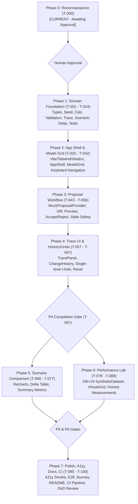

# Phase 0 Repository Reconnaissance Report (T-000)

**Project:** Model Change Review Lab  
**Date:** 2026-10-10  
**Phase:** Phase 0 — Reconnaissance (T-000)  
**Status:** Complete — Awaiting Human Approval Before Phase 1 (T-001)  
**Deliverable:** `docs/reconnaissance.md`

---

## A. Executive Summary

This repository reconnaissance report documents the factual state of the workspace `/home/satjeet/Desktop/drive` prior to beginning implementation of the **Model Change Review Lab**.

### Key Findings
1. **Completely Greenfield Workspace:** The workspace contains no existing application source code (`src/` does not exist), no build configuration (`vite.config.ts`, `tsconfig.json`, `index.html` do not exist), no package manifest (`package.json`), and no dependency lockfiles.
2. **Planning & Requirements Artifacts Present:** The workspace contains the authoritative PRD (`Drivetrain_Model_Change_Review_Lab_PRD_v1.1_Extended.md`) and eight authoritative, synchronized planning documents in `docs/implementation/`:
   - `CODING_AGENT_PROTOCOL.md`
   - `DECISIONS_AND_RISKS.md`
   - `IMPLEMENTATION_MASTER_PLAN.md`
   - `PLANNING_AUDIT.md`
   - `REQUIREMENTS_TRACEABILITY.md`
   - `TASKS.md`
   - `TEST_STRATEGY.md`
   - `UI_SPECIFICATION.md`
3. **Scratch & Backup Artifacts Present:** The workspace includes two non-application directories created during documentation authoring:
   - `backup/`: 7 static `.bak` files from initial drafting passes.
   - `scratch/`: 22 temporary Python scripts and `.bak` snapshots utilized for cross-document synchronization. Neither directory contains production code or dependencies.
4. **Git Repository Status:** Git is **not initialized** in `/home/satjeet/Desktop/drive` (`fatal: not a git repository`).
5. **Runtime Environment & Package Manager Blocker:**
   - Node.js runtime is installed: **v24.11.1**.
   - Package managers installed: `npm` **11.6.2**, `yarn` **1.22.22**, `bun` **1.2.23**.
   - Git CLI is installed: `git version 2.43.0`.
   - **Critical finding on `pnpm`:** Although `pnpm` is present in the path via nvm (`/home/satjeet/.nvm/versions/node/v24.11.1/bin/pnpm`), executing `pnpm -v` fails immediately with a Corepack runtime error: `Cannot find module '/home/satjeet/.cache/node/corepack/v1/pnpm/12.10.1/bin/pnpm.cjs'`. Consequently, `pnpm` is currently non-functional in this environment without Corepack intervention or manual repair, whereas `npm` (v11.6.2) is fully functional and ready out of the box.

### Recommended Next Step
- **Select Option 3 — Create a greenfield application** according to the approved Model Change Review Lab specifications upon human approval.
- **Obtain explicit human approval** on package manager selection (`npm` vs. repairing `pnpm` via Corepack) and Git repository initialization before proceeding to T-001.

---

## B. Environment and Repository Evidence

### 1. Working Directory and Paths
- **Current Working Directory:** `/home/satjeet/Desktop/drive`
- **File System Tree:**
  ```text
  /home/satjeet/Desktop/drive/
  ├── Drivetrain_Model_Change_Review_Lab_PRD_v1.1_Extended.md  (Authoritative PRD, 151,585 bytes)
  ├── docs/
  │   ├── reconnaissance.md                                  (This report)
  │   └── implementation/                                    (Authoritative Planning Set)
  │       ├── CODING_AGENT_PROTOCOL.md
  │       ├── DECISIONS_AND_RISKS.md
  │       ├── IMPLEMENTATION_MASTER_PLAN.md
  │       ├── PLANNING_AUDIT.md
  │       ├── REQUIREMENTS_TRACEABILITY.md
  │       ├── TASKS.md
  │       ├── TEST_STRATEGY.md
  │       └── UI_SPECIFICATION.md
  ├── backup/                                                (Historical planning backups, 7 files)
  └── scratch/                                               (Agent helper scripts & backups, 22 files)
  ```

### 2. Git Version Control State
- **Command:** `git status`
- **Output:** `fatal: not a git repository (or any of the parent directories): .git`
- **Observation:** The project directory is not currently tracked by Git. No `.git/` folder exists, and no commit history or branch context exists.

### 3. Package Manifest and Lockfile Inspection
- `package.json`: **Not found** (unavailable)
- `pnpm-lock.yaml`: **Not found** (unavailable)
- `package-lock.json`: **Not found** (unavailable)
- `yarn.lock`: **Not found** (unavailable)
- `bun.lock` / `bun.lockb`: **Not found** (unavailable)
- `.nvmrc` / `.node-version`: **Not found** (unavailable)
- `node_modules/`: **Not found** (unavailable)

### 4. System Tooling and Runtime Inspection
Commands executed directly on host environment:
| Tool / Command | Command Executed | Version / Result | Status |
|---|---|---|---|
| **Node.js** | `node -v` | `v24.11.1` | Installed & active |
| **npm** | `npm -v` | `11.6.2` | Installed & working |
| **pnpm** | `pnpm -v` | `Error: Cannot find module '/home/satjeet/.cache/node/corepack/v1/pnpm/12.10.1/bin/pnpm.cjs'` | Installed shim, but runtime error |
| **yarn** | `yarn -v` | `1.22.22` | Installed & working |
| **bun** | `bun -v` | `1.2.23` | Installed & working |
| **git** | `git --version` | `git version 2.43.0` | Installed & working |

### 5. Available Scripts and Dependencies
- Available package scripts: **None** (no `package.json` exists).
- Installed local dependencies: **None** (no `node_modules/` exists).

---

## C. Existing Architecture

Inspection confirms:
- **Application Code:** **None.** There are zero `.ts`, `.tsx`, `.js`, `.jsx`, `.html`, or `.css` files outside of documentation/scratch scripts.
- **Framework Entry Points:** None exist (`src/main.tsx`, `src/App.tsx`, `index.html` are absent).
- **Domain Layer:** None exists. No financial types, seed data, calculation engine, validation rules, trace indexes, or transaction managers are implemented.
- **State Management:** None exists. No React context, reducer, or state hooks exist.
- **Component Primitives & UI:** None exist. No UI primitives, design tokens, or layouts exist.
- **Tests & CI:** None exist. No Vitest, React Testing Library, Playwright, or GitHub Actions workflow configurations exist (`.github/` is absent).
- **Deployment:** None exists (`vercel.json` is absent).

---

## D. Feature-by-Feature Assessment

| Capability / Feature Area | PRD / Plan Reference | Observed Status | Supporting File Paths & Notes |
|---|---|---|---|
| **Application Shell & Navigation** | FR-001, UI-02, UI-12 | **Missing** | Not implemented. Planned in `src/components/shell/AppShell.tsx` (Phase 2). |
| **Model Grid & Settings** | FR-003, UI-03 | **Missing** | Not implemented. Planned in `src/components/model/ModelGrid.tsx` (Phase 2). |
| **Editable Cells & Keyboard Flow** | FR-004, UI-03, A11Y-001 | **Missing** | Not implemented. Planned in `src/components/model/EditableAssumptionCell.tsx` and `src/hooks/useKeyboardNavigation.ts` (Phase 2). |
| **Input Validation Rules** | FR-005 | **Missing** | Not implemented. Planned in pure module `src/domain/validation.ts` (Phase 1). |
| **Financial Calculation Engine** | FR-013, CALC-001–003 | **Missing** | Not implemented. Planned in pure module `src/domain/calculation.ts` (Phase 1). |
| **Output Dependency Trace** | FR-014, TRACE-001–002, UI-08 | **Missing** | Not implemented. Planned in `src/domain/trace.ts` (engine P1) and `src/features/trace/TracePanel.tsx` (UI P4). |
| **Deterministic Seed Data** | FR-002 | **Missing** | Not implemented. Planned in pure module `src/domain/seed.ts` (Phase 1). |
| **Proposal Templates & Provider** | FR-007, PROP-001 | **Missing** | Not implemented. Planned in pure module `src/domain/proposals.ts` (Phase 1/3). |
| **Proposal Review & Preview Diff** | FR-008, FR-009, UI-05 | **Missing** | Not implemented. Planned in `src/components/proposals/ProposalReviewPanel.tsx` (Phase 3). |
| **Atomic Commit & Stale Protection** | FR-010, FR-012, PROP-002–004 | **Missing** | Not implemented. Planned in `src/domain/transactions.ts` and `src/state/appReducer.ts` (Phase 1/3). |
| **Proposal Rejection Invariant** | FR-011 | **Missing** | Not implemented. Planned in `src/state/appReducer.ts` (Phase 3). |
| **Baseline Immutability & Scenarios**| FR-015 | **Missing** | Not implemented. Planned in `src/state/appState.ts` (Phase 2). |
| **Scenario Comparison Chart & Delta** | FR-016, UI-07 | **Missing** | Not implemented. Planned in `src/domain/scenarioComparison.ts` (P1) and `src/components/scenario/` (P5). |
| **Transaction History & Single Undo** | FR-017, HIST-001–002 | **Missing** | Not implemented. Planned in `src/state/appReducer.ts` and `src/components/history/` (Phase 4). |
| **Explicit Reset Confirmation** | FR-018, HIST-003 | **Missing** | Not implemented. Planned in `src/components/model/` and `src/state/appReducer.ts` (Phase 4). |
| **10k×24 Synthetic Dataset** | FR-019, PERF-003 | **Missing** | Not implemented. Planned in `src/features/performance/SyntheticDataset.ts` (Phase 6). |
| **Virtualized Performance Grid** | FR-020, PERF-001, UI-10 | **Missing** | Not implemented. Planned in `src/features/performance/VirtualGrid.tsx` (Phase 6). |
| **Performance Measurement Harness**| FR-021, PERF-002 | **Missing** | Not implemented. Planned in `src/features/performance/performanceMeasurements.ts` (Phase 6). |
| **Accessibility Primitives & Smoke** | FR-022, UI-13, A11Y-001–005 | **Missing** | Not implemented. Planned across UI components, `tokens.css`, and `e2e/a11y.spec.ts` (Phase 2/7). |
| **Responsive Stacking Layout** | FR-023 | **Missing** | Not implemented. Planned in `src/components/shell/AppShell.tsx` and styling (Phase 2/7). |
| **Domain & Critical Interaction Tests**| FR-024 | **Missing** | Not implemented. No test files or test runner configured (Phase 1–7). |
| **Disclosure & Architecture Docs** | FR-025, DISC-001, UI-02 | **Partially Implemented** | Planning docs exist in `docs/implementation/`; final user-facing `README.md` is not yet created (Phase 7). |
| **CI Workflow & Prod Verification** | FR-026, UI-14 | **Missing** | Not implemented. `.github/workflows/ci.yml` absent (Phase 7). |
| **Clean Scope & Offline Safety** | FR-027, NFR-002, UI-16 | **Not Yet Evaluated** | No application exists to evaluate yet; this invariant (zero external network dependencies, secrets, analytics, or real AI APIs) must be strictly verified during implementation. |

---

## E. Deviations and Risks

1. **Package Manager Discrepancy (Material Risk):**
   - **Plan assumption:** `DECISIONS_AND_RISKS.md` recorded `ADR-001: Package Manager — pnpm (provisional policy)`.
   - **Observed reality:** Running `pnpm` on the system fails due to a broken Corepack resolution (`Cannot find module '/home/satjeet/.cache/node/corepack/v1/pnpm/12.10.1/bin/pnpm.cjs'`).
   - **Impact:** Attempting to run `pnpm create vite` or `pnpm install` in T-001 will fail immediately unless Corepack is repaired or `npm` (which is fully operational at v11.6.2) is approved as the package manager.
2. **Git Tracking Status:**
   - The workspace `/home/satjeet/Desktop/drive` is not a Git repository. To satisfy revision control, atomic phase commits (`phase-1: ...`), and CI validation, a `git init` should be performed as part of project setup upon approval.
3. **Node 24 Environment:**
   - Active Node version is `v24.11.1`. This is an extremely modern Node release. Vite 6 / Vite 8 and React 19 should be verified for compatibility with Node 24 during T-001/Phase 1.
4. **Scratch and Backup Folders:**
   - `backup/` and `scratch/` exist in the project root. While harmless to the application build, they are uncommitted artifacts. They should be preserved for auditability during Phase 0 and ignored/cleaned up only with human approval.

---

## F. Recommendation

### Selected Option: Option 3 — Create a Greenfield Application

#### Rationale & Evidence:
1. **Inspection Evidence:** Comprehensive inspection confirms that `/home/satjeet/Desktop/drive` contains zero application code, build manifests, or legacy framework structures. There is no existing application to extend (Option 1 is impossible).
2. **No Deletion Needed:** There is no legacy or third-party code that needs replacement (Option 2 is inapplicable).
3. **Specification Alignment:** The project has an authoritative PRD and a fully audited, verified Revision 7 planning document set in `docs/implementation/`. Starting greenfield in Phase 1 (T-001) using the approved stack and modular layout is the safest, cleanest, and lowest-risk path.

---

## G. Proposed Implementation Sequence

The implementation sequence adheres strictly to the phase gate structure established in `IMPLEMENTATION_MASTER_PLAN.md` and `TASKS.md`:



### Phase Details:
1. **Phase 1 — Domain Foundation (T-001 to T-024):**
   - Initialize project structure with approved package manager; configure strict TypeScript (`strict: true`, `noUncheckedIndexedAccess`).
   - Implement pure domain layer without React/browser dependencies (`types.ts`, `seed.ts`, `validation.ts`, `math.ts`, `calculation.ts`, `trace.ts`, `formatting.ts`, `operations.ts`, `transactions.ts`, `scenarioComparison.ts`).
   - Implement comprehensive Vitest domain tests (tests 1–29 per PRD).
2. **Phase 2 — Application Shell and Financial Grid (T-025 to T-042):**
   - Configure Tailwind CSS, design tokens, and shadcn/ui primitives.
   - Build `AppShell` with independent prototype disclosure banner.
   - Implement `ModelGrid` semantic table, editable assumption cells, calculated cells, and keyboard navigation (`useKeyboardNavigation`).
3. **Phase 3 — Proposal Workflow (T-043 to T-056):**
   - Implement `MockProposalProvider` with 3 deterministic templates.
   - Implement `ProposalReviewPanel`, diff visualization, impact preview KPIs, and atomic commit/stale guard logic.
4. **Phase 4 — Trace UI, History and Undo (T-057 to T-067):**
   - Implement `TracePanel` and dependency graph visualization.
   - Implement `ChangeHistory`, single-level snapshot-based `Undo`, and confirmation-guarded `Reset`.
5. **Phase 5 — Scenario Comparison (T-068 to T-077):**
   - Dependent on P4 gate (`T-067`).
   - Implement Recharts scenario comparison line chart, per-period delta table, and cumulative summaries.
6. **Phase 6 — Performance Lab (T-078 to T-089):**
   - Dependent on P4 gate (`T-067`).
   - Implement isolated 10,000 × 24 `SyntheticDataset.ts` and `@tanstack/react-virtual` `VirtualGrid.tsx`.
   - Implement honest performance measurement harness; verify structural constraint (<100 DOM body rows).
7. **Phase 7 — Polish, Accessibility, Documentation and CI (T-090 to T-100):**
   - Accessibility audit, responsive polish, Playwright E2E journey, and Axe smoke tests.
   - Production build verification, CI workflow (`.github/workflows/ci.yml`), user-facing `README.md`, and DoD checklist sign-off.

---

## H. Dependencies and Design-System Recommendations

All proposed dependencies are provisional and must be verified against official documentation during their respective implementation phase:

| Capability Required | Current Repo Support | Candidate Package | Justification & Compatibility Notes | Approval Needed? |
|---|---|---|---|---|
| **Build & Bundler** | None | `vite` | Standard fast React bundler; React 19 support. | Yes (in T-001) |
| **UI Framework** | None | `react`, `react-dom` (v19) | Modern React matching PRD technical baseline. | Yes (in T-001) |
| **Language & Typing**| None | `typescript` (v5.7+) | Strict typing required for financial domain. | Yes (in T-001) |
| **Styling & Tokens** | None | `tailwindcss` (v4), `@tailwindcss/vite` | Modern CSS-first token system. | Yes (in T-025) |
| **Accessible Primitives** | None | `shadcn/ui` (Radix UI primitives) | Accessible dialogs, buttons, tabs, tooltips. | Yes (in T-026) |
| **Icons** | None | `lucide-react` | Lightweight iconography for status/disclosure. | Yes (in T-026) |
| **Data Visualization**| None | `recharts` | PRD §15.1 specification for scenario charts. Note React 19 compatibility. | Yes (in T-068) |
| **Grid Virtualization**| None | `@tanstack/react-virtual` | Headless virtualization strictly for 10k Performance Lab grid. | Yes (in T-079) |
| **Unit & Component Test**| None | `vitest`, `@testing-library/react`, `jsdom` | Fast, Vite-native test runner for domain & UI tests. | Yes (in T-003) |
| **E2E & Accessibility**| None | `@playwright/test`, `@axe-core/playwright` | E2E critical happy path and automated WCAG smoke tests. | Yes (in T-093) |

---

## I. Blockers and Approval Decisions

### Required Human Decisions Before T-001 Implementation Starts:
1. **Approval of Greenfield Approach (Option 3):** Confirm agreement that the workspace is greenfield and authorize proceeding with Phase 1 initialization.
2. **Package Manager Choice:**
   - *Option A (Recommended for immediate stability):* Use standard `npm` (v11.6.2, pre-installed and working).
   - *Option B:* Repair `pnpm` Corepack configuration (`corepack prepare pnpm@... --activate` or reinstalling pnpm globally) to preserve ADR-001's provisional recommendation.
3. **Git Initialization:** Approve running `git init` in `/home/satjeet/Desktop/drive` to enable commit checkpoints for each implementation phase.

---

## J. Phase 0 Completion Checklist

- [x] Repository state thoroughly inspected.
- [x] Package manager and lockfile verified as currently absent; host tooling inspected.
- [x] Framework, dependencies, and scripts recorded (none exist; greenfield confirmed).
- [x] Existing application structure and reusable components inspected (none exist).
- [x] Tests, CI, and deployment examined (none exist).
- [x] PRD and planning documents inspected and confirmed authoritative.
- [x] Recommended implementation approach recorded (Option 3: Greenfield).
- [x] Proposed implementation sequence recorded (Phases 1–7 with strict phase gates).
- [x] No application code, package manifests, lockfiles, or dependencies created or changed.
- [x] Explicit human approval gate preserved: **Implementation STOPPED after T-000 awaiting user approval.**
